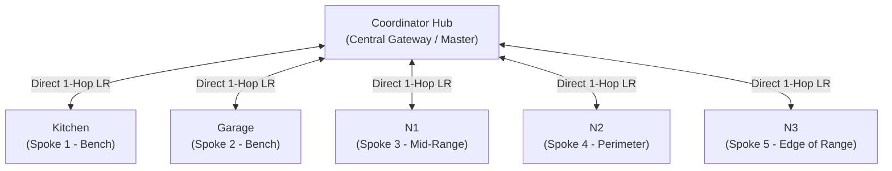
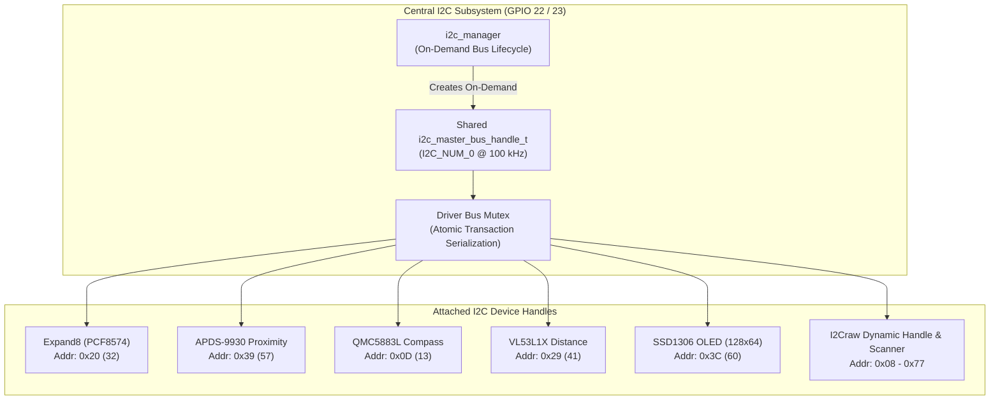
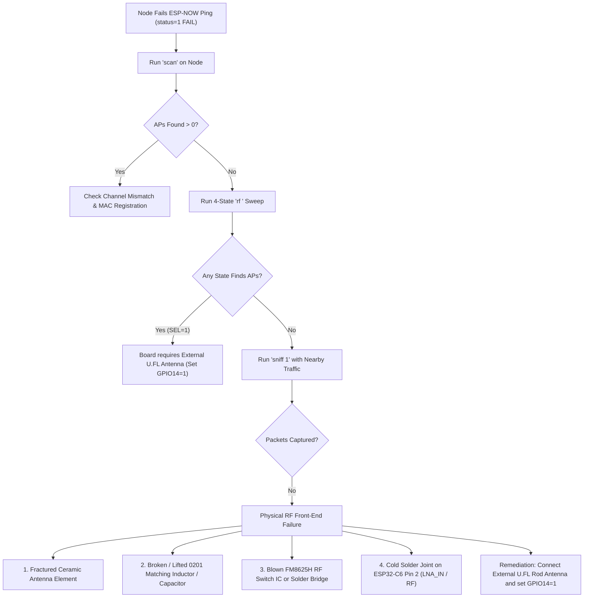
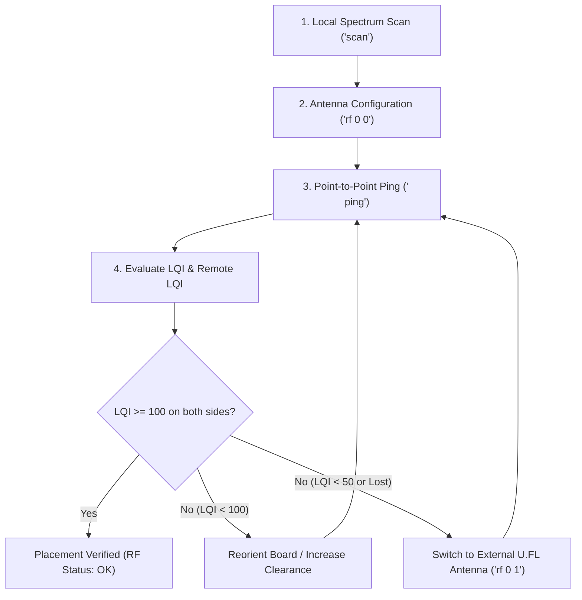
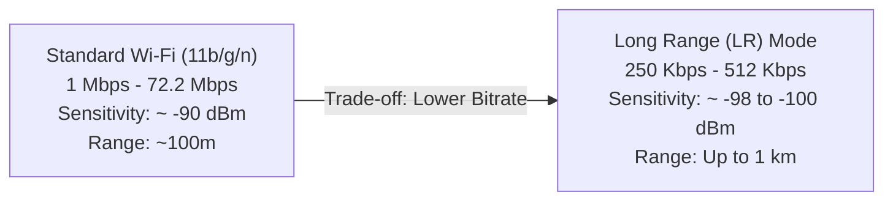
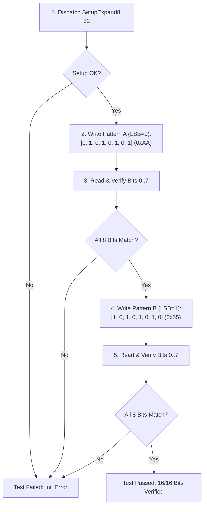

# PNPzigbee Firmware: Architecture, Features & Functional Specification
**Target Platform:** Espressif ESP32-C6 (32-bit RISC-V @ 160MHz)  
**Framework:** ESP-IDF v6.0 | FreeRTOS | Unified ESP-NOW Long Range (LR) Wireless Substrate  
**Network Topology:** Star Topology (Centralized Hub-and-Spoke Architecture)  
**Roles:** Single-Binary Unified Architecture supporting Coordinator Hub (`ROLE_COORDINATOR`), End Device Spoke (`ROLE_END_DEVICE`), and Unprovisioned Workbench (`ROLE_UNPROVISIONED`) via NVS CLI Configuration

---

## 1. Executive Summary

The **PNPzigbee** firmware turns an ESP32-C6 system-on-chip into a versatile, high-reliability actuator and sensor controller. Communicating via a high-performance **Star Network (Hub-and-Spoke Topology)** over 2.4 GHz **ESP-NOW Long Range (LR)** action frames and a local USB/UART console, it bridges central Coordinator Hub commands to a wide array of physical hardware interfaces:
- **Motion & Motors:** DC motors (DRV8833 & Cytron 10C with RF-loss gentle stop fail-safe), 4-phase Bipolar/PWM Steppers (Full/Half/Microstep with current-limiting PWM), 5-wire Unipolar Steppers (`unipolarStep` for Adafruit 28BYJ-48 with Arduino `Stepper` core, half-step mode, and linear acceleration/deceleration ramping), and 4 independent hardware PWM channels with linear slew-rate ramping (supporting hobby servos and multi-channel RGB LED PWM fading).
- **Sensors & I/O Expanders:** Time-of-Flight distance (VL53L1X), optical proximity/ambient light (APDS-9930), 3-axis digital compass/magnetometer (QMC5883L), 8-bit quasi-bidirectional I2C port expander (PCF8574 `Expand8`), 12-bit ADC channels with software Schmitt-trigger hysteresis comparators, dynamic GPIO monitoring, and on-demand I2C bus scanning (`scanI2C`).
- **Visuals & Bridging:** Multi-pixel WS2812B addressable RGB LEDs (`NeoPixel` with configurable strand length, frame buffer, and atomic single-color/clear commands), 128x64 monochrome I2C OLED display (`SSD1306` with multi-size Adafruit GFX `FreeMono` fonts), onboard indicator LED, and a full-duplex hardware UART serial bridge.
- **Resilience:** Single-hop deterministic latency (~20–30 ms), FreeRTOS queue backpressure management, hardware timer arbitration (LEDC arbiter), on-demand zero-pin-leakage I2C bus management (`i2c_manager`), upstream message rate-limiting (`UpstreamQ`), tri-layer dynamic spoke discovery, and over-the-air reboot dispatch.

---

## 2. System Architecture

### 2.1 High-Level Architecture Diagram

```mermaid
flowchart TD
    subgraph Star_and_Host ["Communication Interfaces (Star Topology)"]
        HUB["Coordinator Hub (Master Gateway)"] <--> |Direct 1-Hop 2.4GHz ESP-NOW LR| ZB_STACK["ESP-NOW / Radio Stack"]
        USB["USB Serial Console"] <--> |Interactive CLI| MS["mesh_serial"]
        UART_DEV["External MCU / Device"] <--> |UART1 115200 Baud| SB["serial_bridge"]
    end

    subgraph Core_Dispatch ["Core Dispatch & Processing"]
        ZB_STACK --> |Incoming Action Frame| APP_MSG["app_msg_task (Message Router)"]
        MS --> |User Input| ZB_STACK
        SB <--> |Bi-directional Tunnel| ZB_STACK
        APP_MSG --> PARSER["parse_text_for_local_action"]
        UQ["UpstreamQ (200ms Rate Limiter)"] --> |Unicast / Ack Frame| ZB_STACK
    end

    subgraph Resource_Managers ["Hardware Resource Arbiters"]
        LEDC_MGR["LEDC Resource Manager (6 Ch / 4 Timers)"]
        I2C_MGR["i2c_manager (On-Demand Bus Lifecycle, GPIO 22/23)"]
        ADC_UNIT["ADC1 Oneshot Unit"]
    end

    subgraph Actuator_Subsystems ["Motion & Output Subsystems"]
        PARSER --> PWM["pwm_driver (4 Ch + Linear Slew / RGB Fade)"]
        PARSER --> MOTOR["motor_driver (DRV8833 / Cytron)"]
        PARSER --> STEPPER["Stepper (Full/Half/Micro + Hold)"]
        PARSER --> UNIPOLAR["unipolarStep (28BYJ-48 4-Phase + Accel/Decel)"]
        PARSER --> NEO["NeoPixel (WS2812B RMT + Atomic RGB)"]
        PARSER --> GPIO_OUT["GPIO_handler (Digital Out)"]
        PARSER --> LED["light_driver (Status LED)"]
        PARSER --> EXP8["Expand8 (PCF8574 8-Bit I/O Expander)"]
        PARSER --> SSD1306["SSD1306 (128x64 OLED Display)"]
    end

    subgraph Sensor_Subsystems ["Sensor & Telemetry Subsystems"]
        PARSER --> VL53["VL53L1X ToF Distance"]
        PARSER --> APDS["APDS-9930 Proximity"]
        PARSER --> COMPASS["QMC5883L 3-Axis Magnetometer"]
        PARSER --> ADC_DRV["ADC (A0, A1, A2 + Hysteresis)"]
        PARSER --> GPIO_IN["GPIO_handler (Input Change Detect)"]
        PARSER --> I2C_RAW["I2Craw (Direct Register Access & scanI2C)"]
    end

    PWM --> LEDC_MGR
    MOTOR --> LEDC_MGR
    STEPPER --> LEDC_MGR

    EXP8 --> I2C_MGR
    SSD1306 --> I2C_MGR
    COMPASS --> I2C_MGR
    VL53 --> I2C_MGR
    APDS --> I2C_MGR
    I2C_RAW --> I2C_MGR

    ADC_DRV --> ADC_UNIT

    VL53 -.-> |Threshold / Stream| UQ
    APDS -.-> |Threshold / Stream| UQ
    COMPASS -.-> |Field Telemetry| UQ
    ADC_DRV -.-> |State Change Event| UQ
    GPIO_IN -.-> |Pin Change Event| UQ
```



### 2.2 Network Topology: Star (Hub-and-Spoke) vs. Multi-Hop Mesh Rationale

The system intentionally implements a **Star Topology (Hub-and-Spoke)** rather than a dynamic multi-hop mesh network. In this architecture:
- **Central Master Hub:** The **Coordinator** (`ROLE_COORDINATOR`, Role 2) acts as the central orchestrator and host gateway.
- **Perimeter Spokes:** All remote nodes (`Kitchen`, `Garage`, `N1`, `N2`, `N3`) operate as **End Devices** (`ROLE_END_DEVICE`, Role 1). Unconfigured devices boot into **Workbench Mode** (`ROLE_UNPROVISIONED`, Role 0).
- **Communication Flow:**
  - **Downlink:** Coordinator Hub $\rightarrow$ End Device Spoke (direct single-hop).
  - **Uplink:** End Device Spoke $\rightarrow$ Coordinator Hub (direct single-hop).
  - **No Multi-Hop Relaying:** Spokes do not route or forward packets through peer spokes.



#### Detailed Comparison: Star Topology vs. Multi-Hop Mesh

| Feature / Metric | Star Topology (PNPzigbee Implementation) | Multi-Hop Mesh Topology |
| :--- | :--- | :--- |
| **Round-Trip Latency (RTT)** | **Deterministic & Fast (~20–30 ms)**; single hop in each direction | Variable & Slower (100–300+ ms); scales with hop count and relay queue delays |
| **Firmware & Protocol Complexity** | **Compact, robust, and FreeRTOS task-safe**; non-recursive state machines | Heavy, complex routing engines (AODV, RPL, Dijkstra path calculators) |
| **Network Protocol Chatter** | **Zero background routing overhead**; airwaves reserved for actual commands | Continuous route discovery (RREQ/RREP), route maintenance, and link-status beacons |
| **Failure Domain** | **Strictly isolated**: If one spoke fails or reboots, no other node is affected | **Cascading failures**: If an intermediate routing node drops, its entire downstream subtree loses connectivity |
| **Power & Sleep Feasibility** | **Spokes can enter deep sleep** when idle; Hub buffers or queries on schedule | Relay routers must keep radios powered 100% of the time to forward peer packets |
| **Routing Loops & Flapping** | **Physically impossible**: Flat, non-recursive direct addressing | Susceptible to routing loops, route flapping, and asymmetric link black holes |
| **Link Quality Attribution** | **Direct 1:1 visibility**: Hub monitors exact physical LQI and Remote LQI to each node | Hop-by-hop aggregation masks true physical link degradation |

#### Engineering Rationale for Choosing Star Topology

1. **Deterministic Low Latency & Minimal Jitter:**
   Actuator and motor control (e.g., stopping a DC motor, positioning a stepper, or reading emergency proximity thresholds) requires guaranteed, deterministic execution windows. Single-hop ESP-NOW transactions reliably complete in **20 to 30 ms**, whereas multi-hop mesh routing introduces non-deterministic queuing, route-discovery pauses, and re-convergence delays.

2. **Elimination of Mesh Protocol Overhead & Contention:**
   True multi-hop mesh protocols require continuous background radio broadcasts for neighbor table maintenance, link cost metrics, and route discovery. In a 2.4 GHz spectrum already shared with Wi-Fi and Bluetooth, this background chatter consumes airtime and increases packet collision probability. A star network eliminates 100% of background routing chatter.

3. **Physical RF Coverage via ESP-NOW Long Range (LR) Mode:**
   Multi-hop routing is only physically justified when nodes cannot directly reach the hub (e.g., kilometer-scale agricultural deployments or miles of streetlights). Operating on the ESP32-C6 in **Long Range (LR) Mode** with **+20.0 dBm output power** and high receiver sensitivity (**-98 to -100 dBm** at 250 Kbps spreading), a single central Coordinator easily provides **200–400+ meters line-of-sight** coverage and effortlessly penetrates residential and workshop drywall, wood, and brick walls. Within this physical RF envelope, multi-hop mesh relays add unnecessary complexity and latency without any link budget benefit.

4. **Fault Isolation & High System Availability:**
   In an industrial or home automation setting, nodes may be power-cycled, moved, or firmware-updated independently. In a star network, resetting or losing spoke `N3` has zero impact on `Kitchen` or `Garage`. Conversely, in a mesh network, if a node acting as a parent router restarts, all child nodes dependent on it are abruptly orphaned and must undergo an expensive network rejoin process.

5. **Direct 1:1 Diagnostic Visibility:**
   In the PNPzigbee Star Topology, the Coordinator's active network report (`GiveNetworkReport`) records the exact, unmasked physical uplink and downlink LQI (`LQI` vs. `REMOTE_LQI`) for every physical device. If a node moves or encounters interference, the degradation is immediately visible at the Hub without ambiguity about intermediate link degradation.

6. **Firmware Simplicity & Reliability:**
   *"Simplicity is a prerequisite for reliability"* (Edsger Dijkstra). By keeping the networking topology clean, deterministic, and single-hop, the firmware avoids task deadlocks, memory leaks, dynamic routing table fragmentation, and half-open socket states.

---

## 3. Communication & Star Network Protocol

### 3.1 Star Network Message Flow & Discovery Architecture
Communication in the Star Network ([`discovery.c`](file:///c:/Users/egape/PNPzigbee/main/discovery.c)) operates across three distinct operational layers using packed `espnow_frame_t` frames:

1. **Layer 1: Spoke Announcement on Boot (`HELLO` / `HELLO_ACK`)**
   When an End Device spoke powers on or reboots, `disc_node_task` broadcasts a `HELLO` frame containing its NVS-configured node name and source MAC address using an exponential backoff sequence (`500 ms, 1000 ms, 2000 ms, 5000 ms, 10000 ms`), followed by a 30-second steady-state background heartbeat.
   Upon reception, the Coordinator Hub automatically assigns a 16-bit short address (`0x0001`, `0x0002`, ...), computes the 64-bit EUI-64 IEEE address, inserts the entry into its active routing table, and transmits a unicast `HELLO_ACK` back to the spoke. The spoke then persists the Coordinator's MAC address in NVS (`coord_mac`).

2. **Layer 2: Hub Periodic & Boot Discovery Sweep (`DISCOVER_ALL`)**
   When the Coordinator Hub boots or executes `ResetNetwork`, it broadcasts a Layer 2 discovery request (`DISCOVER_ALL`). All listening spokes immediately lock onto the Coordinator's MAC address, persist it to NVS, and reply with a unicast `HELLO` frame, allowing the Hub to rapidly populate its routing table.

3. **Layer 3: Broadcast Fallback & Passive Reverse Route Learning**
   If an operator or test harness commands a spoke whose route is temporarily absent from the Hub's active RAM table (e.g., following a `ResetNetwork` table wipe), the Hub automatically falls back to a broadcast frame (`FF:FF:FF:FF:FF:FF`). Additionally, any incoming frame from any valid node triggers passive reverse-route learning (`routing_table_add_or_update`), restoring the spoke to the active routing table without losing a single packet.

4. **Over-The-Air Lifecycle Management (`reboot` / `restart`)**
   Spokes support remote wireless reboot dispatch:
   ```text
   <NodeName> reboot
   ```
   The spoke acknowledges receipt (`ACK`), delays 150 ms to ensure frame transmission completes, and calls `esp_restart()`. This enables complete remote testing and recovery without physical access or USB connections.

5. **Single-Binary NVS Provisioning (`nvs_config`)**
   Both the Coordinator Hub and all End Device spokes run the exact same compiled firmware binary. Personality and RF parameters are stored in the `mesh_cfg` NVS namespace and configured interactively via the USB serial workbench CLI (`SetRole Coordinator`, `SetRole EndDevice <Name>`, `SetName`, `SetChannel`, `SetTxPower`, `SetLR`, `ShowConfig`, `FactoryReset`).

### 3.2 Command Grammar & Routing
Incoming text packets are parsed by `parse_text_for_local_action()` using a dual-mode grammar:

1. **Direct Mode (Unicast / Command to self):**
   ```text
   <Command> [Value1] [Value2]
   Example: MotorSpeed 500
   Example: pwm1 800
   Example: NeoRed 0 128
   ```
2. **Targeted Mode (Sub-device / Multi-node addressing):**
   ```text
   <TargetNode> <Command> [Value1] [Value2]
   Example: Kitchen blink 3
   Example: Garage UniStepFwd 512
   ```
   If `<TargetNode>` matches the local device name, the router strips the prefix and executes the command. If the Hub receives the targeted string, it routes the command directly to the designated spoke.

### 3.3 Upstream Throttling (`UpstreamQ`)
To prevent saturation of radio transmission buffers and FreeRTOS task queues, all asynchronous event messages (sensor threshold triggers, digital state changes, telemetry streams) pass through `SendTheMessage()`.
- **Queue Depth:** 10 messages of up to 32 bytes each.
- **Throttling Task:** Dedicated FreeRTOS task enforcing a minimum `200ms` transmission window between outgoing upstream packets.

---

## 4. Hardware Resource Management

### 4.1 LEDC Peripheral Arbiter (`ledc_manager`)
The ESP32-C6 features **6 LEDC PWM channels** and **4 hardware timers** in low-speed mode. Multiple drivers (`pwm_driver`, `motor_driver`, `Stepper`) require PWM generation. The `ledc_manager` prevents peripheral collisions:
- **Timer Sharing:** When a driver requests a timer (e.g., `ledc_manager_alloc_timer(freq_hz, &timer)`), the arbiter first checks if an active timer is already running at that exact frequency. If so, it shares that timer index, saving scarce timer resources.
- **Channel Allocation:** Channels 0 through 5 are allocated dynamically on a first-come, first-served basis with tracking of in-use states.

### 4.2 Shared I2C Bus Subsystem (`i2c_manager`)

The ESP32-C6 star network spoke nodes feature a centralized, thread-safe I2C subsystem managed by [`i2c_manager.c`](file:///c:/Users/egape/PNPzigbee/main/i2c_manager.c) and [`i2c_manager.h`](file:///c:/Users/egape/PNPzigbee/main/i2c_manager.h). Designed for multi-peripheral flexibility and industrial resilience, it hosts distance sensors, optical proximity detectors, 3-axis magnetometers, I/O expanders, OLED displays, and direct bus debug utilities across a single physical 2-wire interface.



#### 4.2.1 On-Demand Bus Lifecycle & "Zero-I2C Application" Architecture
A core architectural requirement of PNPzigbee is maximum hardware versatility: the firmware must gracefully support custom applications that require **zero I2C devices**.
- **Boot-Time Pin Isolation:** At system boot, SCL (`GPIO 23`) and SDA (`GPIO 22`) remain standard unconfigured GPIOs. No I2C driver is created during boot. If an application never uses I2C, both pins remain 100% free for standard digital I/O, PWM channels, or external signaling.
- **Elimination of Implicit / Lazy Initialization:** Earlier firmware architectures lazily initialized the I2C bus whenever any peripheral read or write command was received. This behavior was eliminated. If a user or script issues a command to an uninitialized device (e.g., `Kitchen rdExpand8 0`, `ReadProx`, or `GetCompass`), the driver gracefully rejects the command with an error message (`EXPAND8 NOT READY`, `PROX NOT READY`, `COMPASS NOT READY`, or `ERR: NO I2C ADR SET`) and **leaves the GPIO pins completely untouched**.
- **Explicit On-Demand Allocation:** The shared bus is created *only* when an explicit peripheral setup or bus scan command is executed:
  - `SetupExpand8 [addr]` initializes the bus and attaches the PCF8574 handle.
  - `SetupProximity` initializes the bus and attaches the APDS-9930 handle.
  - `SetupCompass [addr]` initializes the bus and attaches the QMC5883L handle.
  - `SetupVL` initializes the bus and attaches the VL53L1X handle.
  - `SetupDisp [addr]` / `ClearDisp` / `print <size> <text>` initializes the bus and attaches the SSD1306 OLED handle.
  - `rawI2CchipADR <addr>` initializes the bus and attaches the dynamic raw access handle.
  - `scanI2C` / `I2Cscan` initializes the bus and probes all valid 7-bit slave addresses (`0x08`–`0x77`).
- **Pin Reclamation (`i2c_manager_deinit_bus`):** When all I2C operations are completed, calling `i2c_manager_deinit_bus()` tears down the master bus handle and resets both GPIO 22 and 23 via `gpio_reset_pin()`, returning them to high-impedance general-purpose inputs.

#### 4.2.2 ESP-IDF v6.0 Unified `i2c_master` Architecture
The subsystem leverages the modern ESP-IDF v6.0 `driver/i2c_master.h` driver model:
- **Centralized Master Bus:** A single static bus handle (`s_i2c_bus_handle`) owns `I2C_NUM_0`.
- **Multi-Device Handle Attachment:** Rather than opening and closing the bus per transaction, each peripheral driver allocates its own `i2c_master_dev_handle_t` tied to its 7-bit slave address on the shared bus.
- **Electrical Parameters:**
  - **SCL Pin:** `GPIO 23`
  - **SDA Pin:** `GPIO 22`
  - **Clock Frequency:** `100 kHz` Standard Mode (guarantees signal integrity across external wiring harnesses, breadboards, and multi-drop sensor cables).
  - **Hardware Glitch Filter:** `glitch_ignore_cnt = 7` clock cycles, rejecting RF switching noise and inductive motor transients.
  - **Internal Pull-Ups:** Internal pull-ups are enabled (`flags.enable_internal_pullup = true`), operating alongside onboard physical 4.7 kΩ pull-up resistors.

#### 4.2.3 Two-Tier Multi-Device Arbitration & Conflict Prevention
The spoke node supports concurrent operation of up to four or more I2C peripherals on the same physical lines without bus clashes:
1. **Driver-Level Mutex Arbitration:** The ESP-IDF v6.0 `i2c_master` component incorporates an internal FreeRTOS mutex inside the bus structure. When multiple FreeRTOS tasks (such as `vl53_task` and `prox_task`) perform reads, the driver queues and serializes each transaction atomically. No bus transactions can interleave or corrupt data frames.
2. **Task-Level Command Pipeline:** All incoming wireless ESP-NOW frames and USB serial console commands are sequentially processed by a single FreeRTOS task ([`app_msg_task`](file:///c:/Users/egape/PNPzigbee/main/esp_zb_light.c)). Commands are executed in strict arrival order, preventing concurrent access from the network layer.

#### 4.2.4 Address Mapping & Proactive Clash Elimination
The shared bus accommodates standard 7-bit peripheral addresses:

| Peripheral Device | Target Function | 7-Bit Address (Hex) | Address (Dec) | Configuration Command |
| :--- | :--- | :--- | :--- | :--- |
| **QMC5883L** | 3-Axis Digital Compass / Magnetometer | `0x0D` | 13 | `SetupCompass [addr]` (Default: `13` / `0x0D`) |
| **VL53L1X** | Time-of-Flight Distance | `0x29` | 41 | `SetupVL` |
| **APDS-9930** | Optical Proximity / ALS | `0x39` | 57 | `SetupProximity` |
| **SSD1306** | 128x64 Monochrome OLED Display | `0x3C` | 60 | `SetupDisp [addr]` / `ClearDisp` / `print` |
| **PCF8574** | 8-Bit I/O Port Expander | `0x20` – `0x27` | 32 – 39 | `SetupExpand8 [addr]` (Default: `32` / `0x20`) |
| **PCF8574A** | 8-Bit I/O Expander (Variant) | `0x38` – `0x3F` | 56 – 63 | `SetupExpand8 [addr]` |
| **I2Craw** | Direct Register Debugger & Bus Scanner | Dynamic (`0x08`–`0x77`) | Dynamic | `rawI2CchipADR <addr>` / `scanI2C` |

##### Proactive Address Clash Resolution: PCF8574A vs. APDS-9930
* **The Vulnerability:** The alternate PCF8574A address space (`0x38`–`0x3F`) directly encompasses the fixed address of the APDS-9930 optical sensor (`0x39`). In naive address sweep implementations, probing `0x39` receives an ACK from the APDS-9930, causing the I/O expander driver to falsely bind to the optical sensor and corrupt its registers with initial port write states (`0xFF`).
* **The Resolution:** 
  1. **Probe Address Filtering:** The auto-probe routine in [`Expand8.c`](file:///c:/Users/egape/PNPzigbee/main/Expand8.c) explicitly skips address `0x39` (`APDS9930_I2C_ADDR`) during address scans.
  2. **Explicit Address Configuration:** `SetupExpand8` defaults directly to `32` (`0x20`), preventing unnecessary probing. Explicit address targeting (e.g., `SetupExpand8 32`) is recommended and strictly enforced in automated test fixtures.

#### 4.2.5 Transaction Timeouts & System Fault Resilience
To protect the node from hanging due to a disconnected sensor, missing pull-up resistor, or slave clock-stretching lockup:
- **Strict Bounded Timeouts:** All I2C peripheral drivers ([`Expand8.c`](file:///c:/Users/egape/PNPzigbee/main/Expand8.c), [`ssd1306.c`](file:///c:/Users/egape/PNPzigbee/main/ssd1306.c), [`Compass.c`](file:///c:/Users/egape/PNPzigbee/main/Compass.c), [`apds9930.c`](file:///c:/Users/egape/PNPzigbee/main/apds9930.c), [`VL53L1X.c`](file:///c:/Users/egape/PNPzigbee/main/VL53L1X.c), and [`I2Craw.c`](file:///c:/Users/egape/PNPzigbee/main/I2Craw.c)) utilize a bounded timeout of `pdMS_TO_TICKS(100)` (100 ms), and `scanI2C` uses a 20 ms per-address probe timeout.
- **Elimination of Unbounded Waits:** Unbounded `-1` (`portMAX_DELAY`) timeouts have been completely removed. Any transaction encountering bus stall conditions aborts cleanly within 100 ms, logs an error, and returns an error response upstream without starving the FreeRTOS scheduler or delaying adjacent peripherals.

---

## 5. Subsystem Detailed Specifications

### 5.1 Motor & Actuator Drivers

#### 1. DC Motor Driver (`motor_driver`)
Supports bidirectional brushed DC motor control with speed ramp slew rate limiting:
- **Operating Modes:**
  - `Mode 0 (DRV8833)`: Dual-PWM H-Bridge control using 2 LEDC channels (IN1 on GPIO 18, IN2 on GPIO 20).
  - `Mode 1 (Cytron 10C)`: Single PWM speed channel on GPIO 18 + standard GPIO directional pin on GPIO 20.
- **Speed Range:** `-1000` (full reverse) to `+1000` (full forward), `0` = dynamic brake/stop.
- **Slew Rate Generator:** FreeRTOS task (`motor_slew_task`) updates motor output every 20ms according to configurable slew units per second (`MotorSlew`).

#### 2. 4-Phase Bipolar/PWM Stepper Controller (`Stepper`)
Four-pin PWM-chopped phase control for bipolar stepper motors via dual H-bridge drivers such as the HiLetgo DRV8833 ([`Stepper.c`](file:///c:/Users/egape/PNPzigbee/main/Stepper.c)):
- **Default Pins:** `ApGPIO` = 1, `AnGPIO` = 21, `BpGPIO` = 2, `BnGPIO` = 0 (allocates 4 LEDC channels and 1 shared 8-bit LEDC timer at **25,000 Hz (25 kHz)** ultrasonic default so motor coils operate silently without audible whine). Dynamically re-binding pins at runtime resets previous pin matrix mappings via `gpio_reset_pin()` before attaching LEDC channels.
- **Modes:** Full-Step (4-step) and Half-Step (8-step) lookup tables (`FullStep`, `HalfStep`).
- **Active & Holding Current:** `StepPWMduty` sets active drive duty percentage (default 25%), `StepPWMfreq` adjusts the PWM carrier frequency in Hz (default 25,000 Hz), and `HoldPWM` sets a reduced PWM duty cycle when stationary to prevent overheating while maintaining holding torque (0% = freewheel).
- **Motion Profiling:** Configurable acceleration (`Accel`) and deceleration (`Decel`) step counts ramping between `max_ms_per_step` (200 ms) and `msPerStep` (default 20 ms).

#### 3. Unipolar Stepper Controller (`unipolarStep` — Adafruit 28BYJ-48 Small Reduction Stepper)
Dedicated digital 4-phase driver ([`unipolarStep.c`](file:///c:/Users/egape/PNPzigbee/main/unipolarStep.c), [`unipolarStep.h`](file:///c:/Users/egape/PNPzigbee/main/unipolarStep.h)) for 5-wire unipolar reduction stepper motors (such as the Adafruit 28BYJ-48 with 5V center-tap driven by 4 gate-level N-channel MOSFETs):
- **Arduino `Stepper` Core Compatibility:** Direct port of the official Arduino `Stepper.cpp` 4-wire constructor (`Stepper myStepper(stepsPerRevolution, 8, 9, 10, 11)`) with two selectable drive modes (`UniStepMode`):
  - `Mode 0 (Default — Arduino 4-Wire Dual-Coil Full-Step)`:
    - Step 0 (`1010`): Orange (`1`), Pink (`0`), Yellow (`1`), Blue (`0`)
    - Step 1 (`0110`): Orange (`0`), Pink (`1`), Yellow (`1`), Blue (`0`)
    - Step 2 (`0101`): Orange (`0`), Pink (`1`), Yellow (`0`), Blue (`1`)
    - Step 3 (`1001`): Orange (`1`), Pink (`0`), Yellow (`0`), Blue (`1`)
  - `Mode 1 (8-Step Half-Step)`: Alternates single-coil and dual-coil excitation (`Orange` $\rightarrow$ `Orange+Yellow` $\rightarrow$ `Yellow` $\rightarrow$ `Pink+Yellow` $\rightarrow$ `Pink` $\rightarrow$ `Pink+Blue` $\rightarrow$ `Blue` $\rightarrow$ `Orange+Blue`) for smoother micro-motion.
- **Default Pin Assignment & I2C Bus Independence:**
  - **Coil A:** Orange = `GPIO 1` (`motor_pin_1`), Pink = `GPIO 2` (`motor_pin_2`).
  - **Coil B:** Yellow = `GPIO 21` (`motor_pin_3`), Blue = `GPIO 0` (`motor_pin_4`).
  - By routing the Blue phase to `GPIO 0`, the shared I2C pins (`GPIO 22` SDA and `GPIO 23` SCL) remain 100% untouched and available for concurrent sensor/OLED operation.
- **Trapezoidal Acceleration & Deceleration Profiling:**
  - Configured via three parameters:
    - `UniStepDelay0` (alias `UnitStepDelay0`, `UniStepDelay`): Step delay in ms at the start and end of movement (default `10 ms`).
    - `UniStepDelay1` (alias `UnitStepDelay1`): Step delay in ms during constant-velocity cruise (default `10 ms`).
    - `AccelSteps` (alias `UniAccelSteps`): Number of ramp steps $a$ applied to both acceleration and deceleration (`0` = disabled, entire move runs at `UniStepDelay0`).
  - When `AccelSteps` $> 0$ and a move of $n$ cruise steps (`UniStepFwd <n>` or `UniStepBkw <n>`) is commanded, total executed steps are $N_{\text{total}} = 2a + n$:
    1. **Acceleration Phase ($a$ steps):** Step delay linearly interpolates from `Delay0` down to `Delay1`.
    2. **Constant-Velocity Cruise Phase ($n$ steps):** Step delay holds steady at `Delay1`.
    3. **Deceleration Phase ($a$ steps):** Step delay linearly interpolates from `Delay1` back up to `Delay0`.
- **Non-Blocking Execution & Automatic Coil Power-Down:**
  - Commands are queued into a 4-deep FreeRTOS queue (`s_move_queue`) and serviced by `unipolar_task` running at Priority 4, allowing `app_msg_task` (Priority 5) to preempt immediately if `UniStepStop` or telemetry queries arrive mid-move.
  - Step timing uses a hybrid microsecond timer (`delay_ms_float`) combining `vTaskDelay` for coarse intervals ($\ge 25\text{ ms}$) with `esp_rom_delay_us(500)` + `taskYIELD()` loops for sub-tick precision without starving idle/radio tasks.
  - Upon completing any move (or receiving `UniStepStop`), `UnipolarStep_PowerDown()` automatically drives all 4 MOSFET gates LOW (`0`), eliminating quiescent current draw and coil heating.

#### 5. Multi-Channel PWM Driver, Servo Slew & RGB LED Fading (`pwm_driver`)
Provides 4 independent hardware-timed PWM channels (`PWM1`–`PWM4`, [`pwm_driver.c`](file:///c:/Users/egape/PNPzigbee/main/pwm_driver.c)):
- **Hardware Resolution & Defaults:** 10-bit duty cycle resolution (`0` to `1023`), 50 Hz default frequency, and default pin assignments (`PWM1` = GPIO 2, `PWM2` = GPIO 21, `PWM3` = GPIO 4, `PWM4` = GPIO 5).
- **Dynamic Reconfiguration:** Each channel supports runtime GPIO pin reassignment (`pwmPin<1-4> <gpio>`), frequency updates (`pwmFreq<1-4> <hz>`), and linear slew-rate control (`pwmSlew<1-4> <units/sec>`). When a pin is reassigned on an active channel, the previous GPIO is cleanly released via `gpio_reset_pin()`.
- **50 Hz Linear Slew Generator (`pwm_slew_task`):**
  - When `pwmSlew<n>` is `0`, `pwm<n> <duty>` snaps the hardware LEDC duty register instantaneously.
  - When `pwmSlew<n>` $> 0$, `pwm_slew_task` updates the floating-point duty cycle `current_pwm` at **50 Hz (every 20 ms)** by $\Delta = \frac{\text{slew\_rate}}{50}$ counts per tick until `target_pwm` is reached.
- **Application 1 — Hobby Servo Snap vs. Smooth Gliding:**
  - At 50 Hz (20 ms period), 10-bit duty counts map to standard RC servo pulse widths: `51` ($\approx 1.0\text{ ms}$ full left), `77` ($\approx 1.5\text{ ms}$ neutral center), and `102` ($\approx 2.0\text{ ms}$ full right). Setting `pwmSlew1 30` produces smooth, controlled mechanical sweeps across the servo horn.
- **Application 2 — Multi-Channel RGB LED PWM Fading:**
  - By assigning 3 PWM channels (`PWM1` $\rightarrow$ Pin 18 Red, `PWM2` $\rightarrow$ Pin 20 Green, `PWM3` $\rightarrow$ Pin 19 Blue at `1000 Hz`) and setting a coordinated slew rate (e.g. `pwmSlew<1-3> 2046` for a 0.5s ramp across 1023 counts), the ESP32-C6 performs hardware-smooth 0% $\rightarrow$ 100% $\rightarrow$ 0% color fades on individual channels or all three channels simultaneously using only two wireless commands per fade cycle (one for peak target duty, one for off duty).
  - Supports both Common Cathode (`0` = OFF, `1023` = 100% ON) and Common Anode tied to 3.3V (`1023` = OFF, `0` = 100% ON).

#### 6. Addressable RGB Strip (`NeoPixel` / WS2812B)
- **Driver & Configurable Strand Length:** Uses the ESP-IDF `led_strip` RMT backend (`10 MHz` resolution, `LED_STRIP_COLOR_COMPONENT_FMT_GRB`) supporting up to `MAX_PIXELS = 100` (default `16`). `NeoGPIO <gpio> [count]` dynamically configures both the output GPIO pin and the active pixel count (e.g., `NeoGPIO 19 7` or `NeoGPIO 19 16`), re-allocating the strip handle and clearing all pixels to black.
- **Two-Stage RAM Frame Buffer:** `pixel_ram[MAX_PIXELS][3]` supports indexed per-channel staging (`NeoRED <idx> <val>`, `NeoGREEN <idx> <val>`, `NeoBLUE <idx> <val>`) committed in bulk via `NeoUpdate`.
- **Single-Command Atomic Color & Clear Operations:** To minimize wireless packet overhead during strand animations and HIL testing, `NeoPixel.c` provides atomic commands that update the RAM buffer and immediately refresh the physical WS2812B strip in a single transaction:
  - `NeoRed <idx> <val>` (alias `NeoSetRed`): Sets pixel `<idx>` to `(val, 0, 0)` and refreshes immediately.
  - `NeoGreen <idx> <val>` (alias `NeoSetGreen`): Sets pixel `<idx>` to `(0, val, 0)` and refreshes immediately.
  - `NeoBlue <idx> <val>` (alias `NeoSetBlue`): Sets pixel `<idx>` to `(0, 0, val)` and refreshes immediately.
  - `NeoOff <idx>`: Zeroes pixel `<idx>` to `(0, 0, 0)` and refreshes immediately.
  - `NeoClear`: Zeroes the entire RAM buffer and clears the physical strip immediately.

---

### 5.2 Sensor & Telemetry Subsystems

#### 1. Time-of-Flight Distance (`VL53L1X`)
- **Range:** Millimeter-accurate optical distance measurement up to 4 meters.
- **Hysteresis Alerting:** Monitors `VLUpperThresh` and `VLLowerThresh`. Triggers an upstream notification when an object enters or leaves the defined window.
- **Streaming:** Optional real-time distance streaming (`StreamVL 1`).

#### 2. Proximity & Light (`APDS-9930`)
- **Sensing:** Optical infrared proximity with configurable pulse count (`Npulses`).
- **Hysteresis Comparator:** Evaluates upper and lower proximity thresholds (`ProxHighThrsh` / `UpperThresh` and `ProxLowThrsh` / `LowerThresh`); reports state transitions (`Car Detected <val>` / `Car removed <val>`) to the Coordinator, plus on-demand instantaneous queries (`ReadProx` / `ReadProximity` $\rightarrow$ `PROXval <val>`).

#### 3. 12-Bit Analog Input (`adc`)
- **Channels:** `A0` (GPIO 0 / `ADC1_CH0`), `A1` (GPIO 1 / `ADC1_CH1`), `A2` (GPIO 2 / `ADC1_CH2`). Either or both `A0` and `A1` (as well as `A2`) can be configured concurrently as high-impedance analog inputs (internal pull-up/pull-down disabled) with automatic SAR mux settling and 4x oversampling.
- **Comparator Engine (`ADC_MODE_COMPARATOR`):** Software Schmitt-trigger comparator. When the raw analog voltage surpasses `UpperThresh`, comparator sets high; when it drops below `LowerThresh`, comparator clears. State transitions automatically enqueue an upstream event (`ADCcomparator<A0-A2> <1|0>`).
- **Mechanical Detent Potentiometer Mode (`ADCpot` / `ADC_MODE_POT`):** Emulates a mechanical rotary potentiometer with detents (`ADCpot<A0-A2>` or `ADCpot [0-2]`) and configurable detent spacing `PotDetent <X>` (`X` = percent of active span, default 10%).
  - **Active Range Formulation (`[50mV, 3.3V]`):**
    $$\text{ADC\_HW\_FULL\_SCALE\_MV} = 3960.0\,\text{mV} \quad (\text{12-bit SAR saturation at 12 dB attenuation} \rightarrow 4095 \text{ counts})$$
    $$\text{ADC\_FULL\_SCALE\_MV} = 3300.0\,\text{mV} \quad (\text{Potentiometer VDD rail} \rightarrow \approx 3412.5 \text{ counts})$$
    $$\text{ADC\_ZERO\_OFFSET\_MV} = 50.0\,\text{mV} \quad (\text{Zero-floor deadband} \rightarrow \approx 51.7 \text{ counts})$$
    $$\text{effective\_span} = \text{ADC\_FULL\_SCALE\_COUNTS} - \text{ADC\_ZERO\_OFFSET\_COUNTS} \approx 3360.8 \text{ counts}$$
    $$\text{frac} = \frac{\text{raw} - \text{ADC\_ZERO\_OFFSET\_COUNTS}}{\text{effective\_span}} \quad (\text{clamped to } [0.0, 1.0])$$
    $$\text{pos} = \frac{\text{frac}}{X / 100.0}$$
  - **Low-Side Engineering Rationale ($50\,\text{mV}$ Zero Floor & Deadband):**
    1. *Potentiometer Wiper Contact Resistance:* Physical potentiometers rarely achieve true $0.00\,\Omega$ when rotated against the counter-clockwise (CCW) stop; wiper contact, carbon track ends, and lead resistance retain $1\text{--}20\,\Omega$ of residual resistance.
    2. *Motor Driver Ground Bounce & Return Currents:* Heavy DC motor return currents (e.g. Cytron MD10C) circulating through shared PCB traces and ground leads induce $I \times R$ ground voltage offsets ($10\text{--}40\,\text{mV}$). Without an intentional zero floor, this ground shift lifts the apparent wiper voltage above zero, causing motors to creep or whine.
    3. *SAR ADC Low-End Non-Linearity:* The ESP32-C6 SAR ADC at 12 dB attenuation exhibits non-linear response below $\approx 60\text{--}80\,\text{mV}$ and rarely reads 0 raw counts.
    4. *Hysteresis Deadband Trapping & Positive Shut-Off:* Step hysteresis ($0.15$ margin) requires dropping below $0.35$ steps to transition downward into Detent 0. When fine detent thresholds are configured (e.g. 64 detents, step size $\approx 51\,\text{mV}$), the transition threshold drops to $< 20\,\text{mV}$; without a hard floor, slight residual voltage traps the state machine in Detent 1 or 2. An unconditional clamp at $\le 50\,\text{mV}$ forces `pos = 0.0f` and snaps immediately to Detent 0, guaranteeing that full CCW wiper rotation cleanly halts the motor (0% PWM).
    5. *Tactile Operating Feel:* On a standard $270^\circ$ rotary potentiometer, $50\,\text{mV}$ represents $\approx 1.5\%$ of the $3.3\,\text{V}$ rail ($\approx 4^\circ$ of mechanical travel). This provides a natural, positive shut-off deadband matching operator expectations in industrial throttle controls.
  - **High-Side Engineering Rationale ($3.3\,\text{V}$ Rail Alignment):**
    1. *Power Supply Rail Matching:* In ESP32 circuits, potentiometers are powered directly from the $3.3\,\text{V}$ VDD rail to operate within the $3.6\,\text{V}$ absolute maximum GPIO rating without requiring external voltage dividers.
    2. *Eliminating the 83% Ceiling:* While the ESP32-C6 ADC with 12 dB attenuation has a nominal hardware clipping point of $\approx 3.96\,\text{V}$ (4095 counts), a $3.3\,\text{V}$ potentiometer at full clockwise (CW) rotation outputs at most $3.30\,\text{V}$ ($\approx 3412$ counts). If full scale remained calibrated to $3.96\,\text{V}$, full CW rotation would only reach $\approx 83.3\%$ of full-scale ($3300/3960$), preventing the motor driver from ever achieving $100\%$ duty cycle (topping out at Detent 16 of 20).
    3. *True 100% Full-Throttle Reachability:* Scaling `ADC_FULL_SCALE_MV` to $3300.0\,\text{mV}$ ($\approx 3412.5$ counts) normalizes the active potentiometer travel across $[50\,\text{mV}, 3.3\,\text{V}]$, ensuring that full CW rotation reaches $100\%$ full motor throttle ($20/20$ detents or $100\%$ PWM).

#### 4. Dynamic Digital I/O & Link Disconnect Flasher (`GPIO_handler`)
- **Features:** Dynamic pin assignment as inputs (`ModeGPIOin`) or outputs (`ModeGPIOout`, `SetGPIOval`), plus on-demand input reads (`ReadGPIO <pin>` $\rightarrow$ `GPIO <pin> IS <0|1>`).
- **Background Polling:** A 50ms polling task tracks all configured input pins. Any state change instantly generates an upstream report: `GPIO <pin> CHANGED TO <0|1>`.
- **RF Severed Disconnect Flasher (`RFdropBlink <pin> [0|1]` / `ModeRFdropBlink`):**
  - **Purpose & Safety Function:** Provides an automatic, fail-safe visual status indicator on any assigned GPIO output pin (e.g., Garage Pin 18 LED or Kitchen Pin 2). If the RF connection between the spoke end-device and the central Coordinator is severed (due to Coordinator power loss, reboot, range detachment, or severe RF jamming), the node autonomously flashes the pin at **4 Hz** to alert operators of network loss.
  - **Configuration Sequence:**
    1. Configure output mode: `ModeGPIOout <pin>` (e.g. `Garage ModeGPIOout 18`).
    2. Arm RF disconnect blinking: `RFdropBlink <pin>` (or `RFdropBlink <pin> 1`).
    3. To disable and restore steady output: `RFdropBlink <pin> 0` (or issue `RFdropBlink -1` to disarm all pins).
  - **Autonomous Link Loss Detection Engine:**
    - Spoke nodes execute a background connection monitoring loop in `discovery_node_task` polling every **500 ms**.
    - If no frame has been received from the Coordinator for $\ge 1000\text{ ms}$, the spoke dispatches a unicast `HELLO` probe to the Coordinator's learned MAC address.
    - **Trigger Conditions:** If 2 consecutive unicast transmissions fail hardware 802.11 MAC ACK (`ESP_NOW_SEND_FAIL`), or if no inbound communication from the Coordinator occurs for $> 2.0\text{ s}$ (`2000 ms`), the spoke declares the connection **severed** (`mesh_zigbee_is_coordinator_connected() == false`).
  - **Blink Waveform & Hardware Task:**
    - Serviced by a dedicated FreeRTOS background task `rfdrop_blink_task` (Priority 4, 2048 B stack) running on a **125 ms tick** (`vTaskDelay(pdMS_TO_TICKS(125))`).
    - While severed, the task alternates the pin level between `1` and `0` every 125 ms (period = 250 ms = **4 Hz on/off, 50% duty cycle**). Compatible with both active-HIGH and common-anode active-LOW LEDs (such as Garage Pin 18).
  - **Autonomous Link Restoration:**
    - The moment the Coordinator powers back on and any inbound frame is received or a unicast probe is ACKed, `mesh_zigbee_record_coordinator_contact()` immediately resets the failure counters and restores `s_coordinator_connected = true`.
    - `rfdrop_blink_task` detects the active link, ceases toggling immediately, and holds the pin LOW (`0`).
  - **Automated HIL Verification:**
    - Supported directly in [`test_runner.py`](file:///c:/Users/egape/ZigbeeTestRunner/test_runner.py) under Interactive Menu **`[J]`** (or CLI flag `--rfdrop`), which arms `Garage Pin 18`, guides the user to disconnect Coordinator power, verifies the 4 Hz flash, and validates automatic recovery when power is restored.

#### 5. 8-Bit I/O Port Expander (`Expand8` / PCF8574 — Dual-Instance Support)
- **Silicon Architecture:** Quasi-bidirectional 8-bit open-drain I/O expander communicating over the shared I2C bus.
- **Dual-Chip Instance Management (`EXPAND8_MAX_INSTANCES = 2`):** Supports up to **two simultaneous PCF8574 / PCF8574A chips** on the shared I2C bus (e.g., `0x20` / 32 and `0x21` / 33). Each instance maintains its own dedicated `i2c_master_dev_handle_t` and independent 8-bit port state shadow register (`port_state`, initialized to `0xFF` / high-impedance inputs with internal weak pull-ups) so bit-level writes on one chip never clobber the other chip's pin states.
- **Per-Command Address Targeting (Decimal or Hex):** Every command accepts an optional I2C slave address (`8..119` decimal or `0x08..0x77` hex). If `[addr]` is omitted, the command targets the most recently initialized/selected chip. Once `SetupExpand8` has been called at least once, passing a second chip's address to any read/write command automatically allocates and initializes the second instance slot on the fly if not already registered.
- **Bit-Level Operations:**
  - `wrExpand8 <bit> [val] [addr]` (or `wrExpand8 <addr> <bit> <val>`): Writes digital level (0 or 1, default 1) to individual bit index (0–7) on the active or specified chip.
  - `setExpand8 <bit> [addr]` / `clrExpand8 <bit> [addr]`: Atomic bit set / clear operations on the active or specified chip.
  - `rdExpand8 <bit> [addr]` (or `rdExpand8 <addr> <bit>`): Queries individual bit state, returning `EXPAND8 <bit> IS <0|1>`.
- **Byte-Level Operations:**
  - `wrExpand8byte <val> [addr]`: Atomic 8-bit write updating all output pins simultaneously on the active or specified chip.
  - `rdExpand8byte [addr]`: Queries 8-bit port register, returning `EXPAND8 BYTE 0x<HEX>`.
- **Dedicated Telemetry Suppression:** Dedicated telemetry queries (`rdExpand8`, `rdExpand8byte`, `SetupExpand8`) suppress generic `ACK` packets to avoid duplicate frames over the wireless link.

#### 6. Direct Register Debug Tool & Bus Scanner (`I2Craw`)
- **Direct Bus Inspection:** Allows the central coordinator or developer console to perform raw I2C transactions and bus scans without compiling dedicated device drivers.
- **On-Demand Bus Address Scanner (`scanI2C` / `I2Cscan`):** Probes all standard 7-bit addresses (`0x08` through `0x77`) with a 20 ms timeout and returns a formatted list of discovered devices (e.g., `I2C SCAN: 0x0D(13) 0x20(32) 0x3C(60)` or `I2C SCAN: NONE`), suppressing generic `ACK` replies.
- **Dynamic Slave Attachment:** `rawI2CchipADR <addr>` dynamically binds an `i2c_master_dev_handle_t` to any 7-bit slave address.
- **Register Operations:**
  - `rawI2Cwr <reg> <val>`: Transmits 1-byte value to 1-byte register address.
  - `rawI2Crd <reg>`: Transmits register address and receives 1-byte value, returning `I2Cval <reg> <val>`.

#### 7. 128x64 Monochrome OLED Display (`SSD1306`)
- **Silicon Architecture & Framebuffer:** 128x64 monochrome OLED display driven over the shared I2C bus (`0x3C` / 60). Configured in horizontal addressing mode (`0x20, 0x00`) with internal charge pump power enabled (`0x8D, 0x14`). Maintains an internal 1024-byte RAM framebuffer flushed atomically to the display via `i2c_master_transmit`.
- **Adafruit GFX FreeMono Font Engine:** Features a full bit-unpacking glyph renderer utilizing genuine Adafruit GFX font tables stored in flash memory:
  - `FreeMono9pt7b`: Baseline offset 12px, line advance 18px (~11 chars/line, up to 3 lines).
  - `FreeMono12pt7b`: Baseline offset 16px, line advance 24px (~9 chars/line, up to 2 lines).
  - `FreeMono18pt7b`: Baseline offset 24px, line advance 35px (~6 chars/line).
  - `FreeMono24pt7b`: Baseline offset 32px, line advance 47px (~4 chars/line, large banner text).
- **Line Advancement & Auto-Wrapping:**
  - Maintains a persistent vertical cursor coordinate (`s_cursor_y`).
  - Clears the horizontal band (`ssd1306_fill_rect`) across the entire 128-pixel display width before rendering the new line, eliminating visual artifacts from prior text.
  - Computes baseline positioning from the top of the line strip, ensuring glyph ascenders are never clipped at the top of the screen.
  - Increments `s_cursor_y` by the font's `yAdvance` upon successful rendering.
  - When the next line exceeds the 64-pixel display height (`s_cursor_y + yAdvance > 64`), the cursor automatically wraps back to the top (`s_cursor_y = 0`).
- **Commands & Telemetry:**
  - `ClearDisp`: Clears the display to black, zeroes the framebuffer, and resets the line cursor to line 0 (top of screen). Returns `CLEARDISP OK` or `CLEARDISP FAIL`.
  - `print <size> <string>`: Prints arbitrary text string (supports spaces) at specified point size (9, 12, 18, 24; defaults to 12) on current line and advances cursor. Returns `PRINT OK` or `PRINT FAIL`.
  - `SetupDisp [addr]` / `SetupSSD1306 [addr]`: Explicitly creates the shared I2C bus and initializes the SSD1306 hardware at specified 7-bit address (default: `0x3C` / 60). Returns `SETUP DISP OK` or `SETUP DISP FAIL`.
  - Responses suppress generic `[ACK]` frames to optimize wireless bandwidth.

#### 8. 3-Axis Digital Compass & Magnetometer (`QMC5883L`)
- **Silicon Architecture & Distinction:** High-precision 3-axis magnetic sensor communicating over the shared I2C bus at fixed 7-bit slave address `0x0D` (13 decimal).
  > [!NOTE]
  > The QMC5883L is an upgraded silicon design distinct from the legacy Honeywell HMC5883L (`0x1E`). It features higher resolution, lower power consumption, and a completely different internal register architecture.
- **Hardware Configuration Sequence:**
  1. **Software Reset:** Issues soft reset command by setting bit 7 (`0x80`) of Control Register 2 (`0x0A`), followed by a 15 ms settling delay.
  2. **Set/Reset Period Configuration:** Writes `0x01` to Register `0x0B` (mandatory per QMC5883L datasheet specification to charge internal magnetic set/reset coils).
  3. **Continuous Measurement Mode:** Configures Control Register 1 (`0x09`) with `0x1D`:
     - **Mode:** Continuous measurement mode (`0x01`).
     - **Output Data Rate (ODR):** 200 Hz (`0x0C` field mask).
     - **Full Scale Range:** ±8 Gauss (`0x00` field mask, sensitivity ~3000 LSB/Gauss).
     - **Over-Sampling Ratio (OSR):** 512 samples (`0x00` field mask).
  4. **Pointer Roll-Over:** Configures Control Register 2 (`0x0A`) with `0x40` to enable automatic register pointer roll-over across 6-byte bursts.
- **Data Acquisition & Vector Readout:**
  - Performs a single 6-byte burst read starting at output register `0x00` (`[X_LSB, X_MSB, Y_LSB, Y_MSB, Z_LSB, Z_MSB]`).
  - Reconstructs signed 16-bit 2's complement vector components: $X, Y, Z$.
  - In 2D plane navigation, magnetic azimuth heading angle is computed via $\theta = \operatorname{atan2}(Y, X) \times \frac{180}{\pi} \pmod{360^\circ}$.
- **3-Axis Signed Hysteresis Comparator (`compass_task`):**
  - Automatically started upon `SetupCompass`, polling $(X, Y, Z)$ at 20 Hz (50 ms interval) with mutex-protected I2C access.
  - Implements an independent 3-state comparator (`-1`, `0`, `+1`) on each dimension (`X`, `Y`, `Z`) with configurable `[LowMag, HighMag]` thresholds (defaults: `LowMag = 1000`, `HighMag = 2000`) supporting both positive-going `[+LowMag, +HighMag]` and negative-going `[-LowMag, -HighMag]` hysteresis:
    - **Positive-Going Hysteresis:** Transitions to state `1` when $\text{val} > +\text{HighMag}$; remains in state `1` until $\text{val} < +\text{LowMag}$ (returns to `0`, or `-1` if $\text{val} < -\text{HighMag}$).
    - **Negative-Going Hysteresis:** Transitions to state `-1` when $\text{val} < -\text{HighMag}$; remains in state `-1` until $\text{val} > -\text{LowMag}$ (returns to `0`, or `+1` if $\text{val} > +\text{HighMag}$).
  - Enqueues upstream alert messages `Mag<X|Y|Z> <state> <X> <Y> <Z>` (e.g., `MagY 0 520 142 -850`, `MagX 1 2150 120 -300`) containing all three magnetic dimensions at the time of the threshold crossing via `SendTheMessage()` with state tracking so the final resting state is guaranteed never to be dropped.
- **Commands & Telemetry:**
  - `SetupCompass [addr]`: Initializes the shared I2C bus, configures the QMC5883L (default address `13` / `0x0D`), and starts `compass_task`. Returns `SETUP COMPASS OK` or `SETUP COMPASS FAIL`.
  - `GetCompass` / `ReadCompass`: Reads instantaneous magnetic field vector and returns `COMPASS <x> <y> <z>` (e.g. `COMPASS -531 -282 -317`) in raw LSB units, or `COMPASS NOT READY` if uninitialized.
  - `LowMag <val>` / `HighMag <val>` (plus per-axis `LowMag<X|Y|Z> <val>`, `HighMag<X|Y|Z> <val>`): Configures the positive `[LowMag, HighMag]` and negative `-[LowMag, HighMag]` hysteresis thresholds (default `[1000, 2000]`).
  - Telemetry frames automatically suppress generic `[ACK]` packets across the wireless mesh.

---

### 5.3 Communication Bridges & Consoles

#### 1. Hardware UART Bridge (`serial_bridge`)
- **Peripheral:** `UART_NUM_1` (TX: GPIO 17, RX: GPIO 16 @ 115200 baud).
- **Operation:** Completely transparent bidirectional link between the wireless star network and a connected microcontroller (e.g., Arduino SAMD21 `TXRXproto`, host PC, or sensor board).

#### 2. USB Serial Console (`mesh_serial` & `serial_gateway`)
- **Peripheral:** ESP32-C6 USB-Serial/JTAG controller.
- **Interactive Shell:** Local terminal interface with line editing, backspace handling, command echoing, NVS Workbench provisioning (`nvs_config_handle_cli`), and direct message forwarding (`coordinator> ` prompt on Coordinator Hub, `node> ` prompt on End Devices, `workbench> ` prompt on Unprovisioned nodes).

---

## 6. FreeRTOS Task Hierarchy

| Task Name | Role | Core / Pri | Stack Size | Purpose |
| :--- | :--- | :--- | :--- | :--- |
| `app_msg_task` | End Device | Core 0 / P5 | 3072 B | Central message dispatcher; parses and executes commands from ESP-NOW/serial |
| `mesh_tx_task` | End Device | Core 0 / P5 | 3072 B | Consumes `s_mesh_tx_queue` and transmits ESP-NOW frames with broadcast fallback |
| `disc_node_task` | End Device | Core 0 / P5 | 3072 B | Layer 1 exponential-backoff `HELLO` boot announcer & active 500ms link loss heartbeat monitor |
| `serial_console_task`| End / Unprov | Core 0 / P5 | 3072 B | Interactive USB console reader, line editor, RF CLI, and NVS provisioning shell |
| `button_task` | End Device | Core 0 / P5 | 2048 B | 20ms debounced monitor for physical boot button (GPIO 9) |
| `throttle_task` | End Device | Core 0 / P5 | 2048 B | Upstream message queue consumer (`UpstreamQ`, 200ms rate limiter) |
| `gpio_poll_task` | End Device | Core 0 / P5 | 2048 B | 50ms periodic digital input pin state change scanner |
| `rfdrop_blink_task` | End Device | Core 0 / P4 | 2048 B | 125ms RF disconnect blink generator (4 Hz flash on severed coordinator connection) |
| `motor_slew_task` | End Device | Core 0 / P5 | 2048 B | 20ms DC motor speed ramp generator (`motor_driver`) |
| `pwm_slew_task` | End Device | Core 0 / P5 | 2048 B | 20ms (50Hz) 4-channel linear PWM duty cycle ramp generator (`pwm_driver`) |
| `stepper_task` | End Device | Core 0 / P5 | 2048 B | 4-phase PWM-chopped stepper sequencing, ramping, and holding torque task |
| `unipolar_task` | End Device | Core 0 / P4 | 3072 B | 4-phase unipolar stepper worker task with trapezoidal accel/decel & auto power-down |
| `vl53_task` | End Device | Core 0 / P5 | 3072 B | 50ms ToF distance reading, filtering, and threshold check |
| `prox_task` | End Device | Core 0 / P5 | 3072 B | 20ms optical proximity reading and threshold evaluation |
| `compass_task` | End Device | Core 0 / P5 | 3072 B | 50ms 3-axis QMC5883L magnetic field reading and signed `[LowMag, HighMag]` hysteresis comparator |
| `adc_task` | End Device | Core 0 / P5 | 2048 B | Periodic round-robin analog sampling and Schmitt-trigger hysteresis evaluation |
| `serial_bridge_rx_task` | End Device | Core 0 / P5 | 2048 B | Hardware UART1 character receiver and line buffer |
| `coord_mesh_tx` | Coordinator | Core 0 / P5 | 3072 B | Coordinator outgoing ESP-NOW frame dispatcher |
| `coord_app_msg` | Coordinator | Core 0 / P5 | 3072 B | Coordinator inbound telemetry/ACK processor and auto-ACK responder |
| `coord_console` | Coordinator | Core 0 / P5 | 3072 B | Coordinator interactive USB gateway CLI (`GiveNetworkReport`, `PingNetwork`, etc.) |
| `fresh_report_task` | Coordinator | Core 0 / P4 | 3072 B | Transient task collecting live `PONG` responses for `GiveNetworkReport` (3s timeout) |

---

## 7. Complete Command Reference Dictionary

All commands can be sent over the air from the Coordinator Hub (`<TargetNode> <Command> [args]`) or typed directly in the local USB serial console.

### 7.1 System, Provisioning & Coordinator Gateway Commands
| Command | Parameters | Description | Response / Event |
| :--- | :--- | :--- | :--- |
| `PING` | *none* | Test link connectivity and measure bidirectional LQI | `PONG LQI=<val>` |
| `blink` | `<count> [ms]` | Blink onboard status LED `count` times with `ms` period | `OK` / `[ACK]` |
| `on` | *none* | Turn standard light state ON | `GOT ON OK` / `[ACK]` |
| `off` | *none* | Turn standard light state OFF | `GOT OFF OK` / `[ACK]` |
| `reboot`, `restart` | *none* | Remotely reboot target node after 150ms ACK flush | `[ACK]` / `REBOOTING` |
| `SetupSerialBridge` | *none* | Initialize hardware UART1 serial bridge on GPIO 16/17 | `SETUP SERIAL OK` |
| `GiveNetworkReport` | *none* | *(Coordinator CLI)* Ping all nodes and print live CSV network report | `NETWORK_REPORT_BEGIN...END` |
| `PingNetwork` | *none* | *(Coordinator CLI)* Queue unicast `PING` to all registered nodes | `PING_NETWORK_BEGIN...END` |
| `ResetNetwork` | *none* | *(Coordinator CLI)* Clear RAM routing table and broadcast `DISCOVER_ALL` | `RESET_NETWORK_BEGIN...END` |
| `ResetCoordinator` | *none* | *(Coordinator CLI)* Reboot the Coordinator Hub | `RESET_COORDINATOR_RESTARTING` |
| `SetRole` | `Coordinator \| EndDevice <Name> \| Unprovisioned` | *(USB CLI)* Provision device role in NVS and reboot | `[NVS] Configuration committed` |
| `SetName` | `<NewName>` | *(USB CLI)* Persist node name (max 16 chars) in NVS | `[NVS] Writing name... OK` |
| `SetChannel` | `<1-14>` | *(USB CLI)* Persist and tune 2.4 GHz Wi-Fi/ESP-NOW channel | `[NVS] Writing channel... OK` |
| `SetTxPower` | `<8-84>` | *(USB CLI)* Set max TX power in 0.25 dBm units (`80` = +20.0 dBm) | `[NVS] Writing TX power... OK` |
| `SetLR`, `SetLongRange` | `<0\|1>` | *(USB CLI)* Enable/disable ESP-NOW Long Range (250 Kbps) PHY | `[NVS] Writing Long Range... OK` |
| `ShowConfig`, `config` | *none* | *(USB CLI)* Print role, name, MAC, RF settings, and uptime | `[CONFIG] Role: ...` |
| `FactoryReset` | *none* | *(USB CLI)* Erase `mesh_cfg` NVS namespace and reboot | `[NVS] Reverted to factory defaults` |

### 7.2 PWM Subsystem (Servos & RGB LED Fading)
| Command | Parameters | Description | Response / Event |
| :--- | :--- | :--- | :--- |
| `SetupPWM<1-4>` | *none* | Allocate hardware timer/channel for PWM channel 1–4 | `SETUP PWM<n> OK` / `[ACK]` |
| `pwmPin<1-4>` | `<gpio>` | Assign output GPIO pin to PWM channel (defaults: 2, 21, 4, 5) | `GOT PWMPIN<n> OK` / `[ACK]` |
| `pwmFreq<1-4>` | `<freq_hz>` | Set frequency in Hz for PWM channel (default: 50 Hz) | `GOT PWMFREQ<n> OK` / `[ACK]` |
| `pwmSlew<1-4>` | `<units/sec>` | Set linear duty ramp rate (`0` = instantaneous snap) | `GOT PWMSLEW<n> OK` / `[ACK]` |
| `pwm<1-4>` | `<duty>` | Set target 10-bit duty cycle (`0` to `1023`) | `GOT PWM<n> OK` / `[ACK]` |

### 7.3 DC Motor Driver (`motor_driver`)
| Command | Parameters | Description | Response / Event |
| :--- | :--- | :--- | :--- |
| `SetupMotorDriver` | `<mode> <freq>` | Init DC motor (`0`=DRV8833, `1`=Cytron 10C) at `freq` Hz | `GOT MOTORSPEED OK` / `[ACK]` |
| `MotorSpeed` | `<speed>` | Set motor speed and direction (`-1000` to `+1000`) | `GOT MOTORSPEED OK` / `[ACK]` |
| `MotorSlew` | `<rate>` | Set speed ramp rate (speed units / second) | `GOT MOTORSLEW OK` / `[ACK]` |
| `GetRFlossThrottle` | *none* | Query current fail-safe RF throttle factor (`0.00` to `1.00`) | `RFlossThrottle <val>` |

### 7.4 4-Phase PWM Stepper Motor (`Stepper`)
| Command | Parameters | Description | Response / Event |
| :--- | :--- | :--- | :--- |
| `SetupStepper` | *none* | Initialize or re-bind PWM-chopped stepper driver subsystem | `SETUP STEPPER OK` / `[ACK]` |
| `ApGPIO`, `AnGPIO` | `<gpio>` | Set Phase A positive / negative GPIO pins (defaults: 1, 21) | `GOT APGPIO/ANGPIO OK` / `[ACK]` |
| `BpGPIO`, `BnGPIO` | `<gpio>` | Set Phase B positive / negative GPIO pins (defaults: 2, 0) | `GOT BPGPIO/BNGPIO OK` / `[ACK]` |
| `FullStep` | *none* | Select 4-step Full-Step drive mode | `GOT FULLSTEP OK` / `[ACK]` |
| `HalfStep` | *none* | Select 8-step Half-Step drive mode | `GOT HALFSTEP OK` / `[ACK]` |
| `msPerStep` | `<ms>` | Set target cruise delay between steps in milliseconds | `GOT MSPERSTEP OK` / `[ACK]` |
| `Step` | `<steps>` | Move stepper specified number of steps (signed) | `GOT STEP OK` / `[ACK]` |
| `StepPWMduty` | `<duty_pct>` | Set active drive PWM duty cycle percentage (0–100) | `GOT STEPPWMDUTY OK` / `[ACK]` |
| `StepPWMfreq` | `<freq_hz>` | Set PWM carrier frequency in Hz (default: 25000 Hz) | `GOT STEPPWMFREQ OK` / `[ACK]` |
| `HoldPWM` | `<duty_pct>` | Set stationary holding torque PWM duty cycle (0–100) | `GOT HOLDPWM OK` / `[ACK]` |
| `Accel`, `Decel` | `<steps>` | Set ramp acceleration / deceleration step counts | `GOT ACCEL/DECEL OK` / `[ACK]` |

### 7.5 Unipolar Stepper Motor (`unipolarStep` — Adafruit Small Reduction Stepper)
Supports 5-wire unipolar steppers (e.g. Adafruit 28BYJ-48 small reduction stepper with 5V center-tap and gate-level N-channel MOSFET drivers), using the official Arduino `Stepper` library 4-wire sequence (`Stepper myStepper(200, 8, 9, 10, 11)`):
- **Coil A:** Orange (XIAO Pin 1 $\leftrightarrow$ Arduino Pin 8), Pink (XIAO Pin 2 $\leftrightarrow$ Arduino Pin 9)
- **Coil B:** Yellow (XIAO Pin 21 $\leftrightarrow$ Arduino Pin 10), Blue (XIAO Pin 0 $\leftrightarrow$ Arduino Pin 11)
- **Step Sequence:** Step 0: Orange & Yellow; Step 1: Pink & Yellow; Step 2: Pink & Blue; Step 3: Orange & Blue.
- Coils are automatically powered down when movement finishes to eliminate heat and idle current draw.
- **I2C Bus Independence:** Operating Blue on GPIO 0 leaves D4 (GPIO 22) and D5 (GPIO 23) 100% free, allowing simultaneous I2C sensor/display operation alongside stepper motion.
- *Note:* All unipolar commands accept either space-delimited (`UniStepDelay0 40`) or `=` assignment (`UniStepDelay0=40`) syntax.

| Command | Parameters | Description | Response / Event |
| :--- | :--- | :--- | :--- |
| `SetupUnipolar` | *none* | Initialize 4-phase unipolar stepper driver on XIAO Pins 1, 2, 21, 0 | `SETUP UNIPOLAR OK` / `[ACK]` |
| `UniStepFwd` | `<steps>` | Step forward by N constant-velocity steps (plus $2 \times \text{AccelSteps}$ ramp if enabled) | `GOT UNISTEPFWD <N> OK` / `[ACK]` |
| `UniiStepBkw`, `UniStepBkw` | `<steps>` | Step backward by N constant-velocity steps (plus $2 \times \text{AccelSteps}$ ramp if enabled) | `GOT UNISTEPBKW <N> OK` / `[ACK]` |
| `UniStepStop` | *none* | Immediately halt motion, flush move queue, and power down all 4 coils | `GOT UNISTEPSTOP OK` / `[ACK]` |
| `UnitStepDelay0`, `UniStepDelay0`, `UniStepDelay` | `<ms>` | Set step delay at start and end of movement in ms (default 10ms) | `GOT UNISTEPDELAY0 <ms> OK` / `[ACK]` |
| `UnitStepDelay1`, `UniStepDelay1` | `<ms>` | Set step delay during constant velocity cruise in ms (default 10ms) | `GOT UNISTEPDELAY1 <ms> OK` / `[ACK]` |
| `AccelSteps`, `UniAccelSteps` | `<steps>` | Set ramp steps to accelerate from Delay0 to Delay1, and decelerate from Delay1 to Delay0 (`0` = disabled) | `GOT ACCELSTEPS <steps> OK` / `[ACK]` |
| `UniStepMode` | `<mode>` | Set stepping mode: `0`=Arduino Stepper 4-wire full-step (default), `1`=Half-step (8-step) | `GOT UNISTEPMODE <mode> OK` / `[ACK]` |

### 7.6 NeoPixel (Addressable RGB — WS2812B)
| Command | Parameters | Description | Response / Event |
| :--- | :--- | :--- | :--- |
| `NeoGPIO` | `<gpio> [count]` | Assign output pin and initialize LED strip with configurable pixel count (e.g. `NeoGPIO 19 7`, default 16, max 100) | `GOT NEOGPIO OK` / `[ACK]` |
| `NeoRED` | `<index> <val>` | Set red component (0–255) for pixel index in RAM buffer | `GOT NEORED OK` / `[ACK]` |
| `NeoGREEN`| `<index> <val>` | Set green component (0–255) for pixel index in RAM buffer | `GOT NEOGREEN OK` / `[ACK]` |
| `NeoBLUE` | `<index> <val>` | Set blue component (0–255) for pixel index in RAM buffer | `GOT NEOBLUE OK` / `[ACK]` |
| `NeoUpdate`| *none* | Flush RAM buffer to physical WS2812B strip | `GOT NEOUPDATE OK` / `[ACK]` |
| `NeoRed`, `NeoSetRed` | `<index> <val>` | Set pixel index to pure Red (zeroes Green/Blue) and refresh strip immediately | `GOT NEORED OK` / `[ACK]` |
| `NeoGreen`, `NeoSetGreen` | `<index> <val>` | Set pixel index to pure Green (zeroes Red/Blue) and refresh strip immediately | `GOT NEOGREEN OK` / `[ACK]` |
| `NeoBlue`, `NeoSetBlue` | `<index> <val>` | Set pixel index to pure Blue (zeroes Red/Green) and refresh strip immediately | `GOT NEOBLUE OK` / `[ACK]` |
| `NeoOff` | `<index>` | Atomically zero RGB of pixel index in buffer and refresh strip immediately | `GOT NEOOFF OK` / `[ACK]` |
| `NeoClear` | *none* | Atomically zero all pixels in buffer and clear physical strip immediately | `GOT NEOCLEAR OK` / `[ACK]` |

### 7.7 Analog & Digital I/O
| Command | Parameters | Description | Response / Event |
| :--- | :--- | :--- | :--- |
| `SetupADC<A0-A2>` (or `SetupADC <0-2>`) | *none* / `<0-2>` | Initialize 12-bit ADC channel (`A0`=GPIO0, `A1`=GPIO1, `A2`=GPIO2) in comparator mode | `SETUP ADC<ch> OK` / `[ACK]` |
| `ADCpot<A0-A2>` (or `ADCpot [0-2]`, `SetupADCpot<A0-A2>`) | *none* / `<0-2>` | Initialize/switch ADC channel (`A0`–`A2`) into mechanical detent pot mode (`ADC_MODE_POT`) | `SETUP ADCPOT<ch> OK` / `[ACK]`, async `ADCpot<ch> <detent>` |
| `PotDetent` (or `PotDetent<A0-A2>`) | `<X>` (`1–100`) | Set detent step size `X` as percent of active span (`[50mV, 3.3V]`, default `10%`) | `GOT POTDETENT <X> OK` / `[ACK]` |
| `ReadADC<A0-A2>` (or `ReadADC <0-2>`) | *none* / `<0-2>` | Read instantaneous raw 12-bit ADC value on selected channel | `ADCval<ch> <val>` |
| `ADCupperThresh<A0-A2>` | `<val>` | Set upper trigger threshold for hysteresis | `GOT ADCUPPERTHRESH<ch> OK` / `[ACK]` |
| `ADCLowerThresh<A0-A2>` | `<val>` | Set lower trigger threshold for hysteresis | `GOT ADCLOWERTHRESH<ch> OK` / `[ACK]` |
| `SetupGPIOhandler` | *none* | Start background GPIO state change detector | `SETUP GPIO OK` / `[ACK]` |
| `ModeGPIOin` | `<gpio>` | Configure pin as digital input with pull-up | `GOT MODEIN OK` / `[ACK]` |
| `ModeGPIOout` | `<gpio>` | Configure pin as digital output | `GOT MODEOUT OK` / `[ACK]` |
| `RFdropBlink` | `<gpio> [0\|1]` | Blink GPIO at 4 Hz (4x/sec, 125ms ON/OFF) when RF connection to coordinator is severed (`1` to arm, `0` to disarm; e.g. `RFdropBlink 18`) | `GOT RFDROPBLINK OK` / `[ACK]` |
| `ModeRFdropBlink` | `<gpio> [0\|1]` | Alias for `RFdropBlink` | `GOT RFDROPBLINK OK` / `[ACK]` |
| `SetGPIOval` | `<gpio> <val>` | Set digital output level (0 or 1) | `GOT SETGPIO OK` / `[ACK]` |
| `ReadGPIO` | `<gpio>` | Query digital input level | `GPIO <pin> IS <0\|1>` |

### 7.8 I2C Peripherals: Distance, Proximity, I/O Expander, OLED Display, 3-Axis Compass & Raw Bus Access
| Command | Parameters | Description | Response / Event |
| :--- | :--- | :--- | :--- |
| `SetupCompass` | `[addr]` | Initialize QMC5883L 3-axis compass (default: 13 / `0x0D`) & start comparator task | `SETUP COMPASS OK` / `SETUP COMPASS FAIL` |
| `GetCompass`, `ReadCompass` | *none* | Read instantaneous 3-axis magnetic field vector (X, Y, Z) | `COMPASS <x> <y> <z>` / `COMPASS NOT READY` |
| `LowMag`, `HighMag` | `<val>` | Set signed 3-axis compass hysteresis thresholds `[LowMag, HighMag]` & `-[LowMag, HighMag]` (default `[1000, 2000]`; also supports `LowMag<X\|Y\|Z>`, `HighMag<X\|Y\|Z>`) | `GOT LOWMAG/HIGHMAG OK` / `[ACK]` (Events: `Mag<X\|Y\|Z> <1\|0\|-1> <X> <Y> <Z>`) |
| `StreamCompass` | `<0\|1>` | Enable/disable live compass vector serial streaming | `COMPASS STREAM ON/OFF` |
| `SetupExpand8` | `[addr]` | Initialize PCF8574 I/O expander instance ( up to 2 chips; default addr: 32 / `0x20`) | `SETUP EXPAND8 OK` / `FAIL` |
| `wrExpand8` | `<bit> [val] [addr]` | Write bit 0–7 (val: 0 or 1, default 1) on active or `[addr]` chip | `EXPAND8 WR OK` / `FAIL` |
| `rdExpand8` | `<bit> [addr]` | Read individual bit 0–7 on active or `[addr]` chip | `EXPAND8 <bit> IS <0\|1>` |
| `setExpand8` | `<bit> [addr]` | Set bit 0–7 HIGH (1) on active or `[addr]` chip | `EXPAND8 WR OK` |
| `clrExpand8` | `<bit> [addr]` | Clear bit 0–7 LOW (0) on active or `[addr]` chip | `EXPAND8 WR OK` |
| `wrExpand8byte` | `<byte> [addr]` | Atomic 8-bit port write (0–255) on active or `[addr]` chip | `EXPAND8 WR OK` / `FAIL` |
| `rdExpand8byte` | `[addr]` | Read full 8-bit port state on active or `[addr]` chip | `EXPAND8 BYTE 0x<HEX>` |
| `ClearDisp` | *none* | Clear SSD1306 display & reset line cursor to top | `CLEARDISP OK` / `CLEARDISP FAIL` |
| `print` | `<size> <text>` | Render text in FreeMono (size: 9, 12, 18, 24) and advance line | `PRINT OK` / `PRINT FAIL` |
| `SetupDisp`, `SetupSSD1306` | `[addr]` | Initialize SSD1306 OLED display (default: 60 / `0x3C`) | `SETUP DISP OK` / `SETUP DISP FAIL` |
| `SetupVL` | *none* | Init VL53L1X ToF sensor & start distance task | `SETUP VL OK` / `FAIL` |
| `StreamVL` | `<0\|1>` | Enable/disable live distance streaming | `VL STREAM ON/OFF` |
| `VLUpperThresh` | `<mm>` | Set distance upper alert threshold | `GOT VLUPPERTHRESH OK` |
| `VLLowerThresh` | `<mm>` | Set distance lower alert threshold | `GOT VLLOWERTHRESH OK` |
| `SetupProximity` | *none* | Init APDS-9930 proximity sensor & start task | `SETUP PROX OK` / `FAIL` |
| `ReadProx`, `ReadProximity` | *none* | Read instantaneous optical proximity level | `PROXval <val>` / `PROX NOT READY` |
| `StreamProx` | `<0\|1>` | Enable/disable live proximity streaming | `PROX STREAM ON/OFF` |
| `Npulses` | `<count>` | Set optical IR emitter pulse count | `GOT NPULSES OK` |
| `ProxHighThrsh`, `ProxLowThrsh` | `<val>` | Set proximity upper and lower hysteresis alert thresholds (aliases: `UpperThresh`, `LowerThresh`) | `GOT PROXHIGHTHRSH/PROXLOWTHRSH OK` / `[ACK]` |
| `scanI2C`, `I2Cscan` | *none* | Scan shared I2C bus (`0x08`–`0x77`) and list active slave addresses | `I2C SCAN: 0xXX(YY)...` / `I2C SCAN: NONE` |
| `rawI2CchipADR` | `<7bit_addr>` | Select target I2C slave address | `I2C CHIP ADR OK` / `FAIL` |
| `rawI2Cwr` | `<reg> <val>` | Write 1 byte to register over I2C | `I2C WR OK` / `FAIL` |
| `rawI2Crd` | `<reg>` | Read 1 byte from register over I2C | `I2Cval <reg> <val>` / `FAIL` |

---

## 8. Memory & Partition Layout

The firmware utilizes a custom partition table optimized for NVS configuration persistence (`mesh_cfg`), radio calibration, and application headroom:

```csv
# Name,       Type, SubType, Offset,   Size,    Flags
nvs,          data, nvs,     0x9000,   0x6000,
phy_init,     data, phy,     0xf000,   0x1000,
factory,      app,  factory, 0x10000,  900K,
zb_storage,   data, fat,     0xf1000,  16K,
zb_fct,       data, fat,     0xf5000,  1K,
```
- **Application Binary Footprint:** ~600 KB (`0x92910` bytes).
- **Available App Partition Headroom:** ~35% free space remaining in the 900 KB factory partition.
- **Non-Volatile Storage (NVS):** Persists node role (`ROLE_COORDINATOR`, `ROLE_END_DEVICE`, `ROLE_UNPROVISIONED`), node name, RF channel, TX power, Long Range mode enable flag, and learned Coordinator MAC address across power cycles.

---

## 9. Hardware-in-the-Loop Test Fixture: TXRXproto

### 9.1 Overview & System Role

The **`TXRXproto`** project (located in `C:\Users\egape\TXRXproto`) serves as the dedicated **Hardware-in-the-Loop (HIL) verification fixture and downstream client** for the PNPzigbee network. 

Physically wired to the ESP32-C6 node's hardware UART serial bridge, `TXRXproto` provides immediate visual and serial feedback confirming that packets sent from the remote Coordinator Hub successfully traverse the wireless ESP-NOW Long Range link, get dispatched across the node's serial bridge, and arrive uncorrupted at the end-actuator.

```text
┌─────────────────────────────────┐
│     PuTTY / Host PC Terminal     │
└───────────────┬─────────────────┘
                │ Serial Console ("Kitchen blinkx 5")
                ▼
┌─────────────────────────────────┐
│    Coordinator Hub (ESP32-C6)   │
└───────────────┬─────────────────┘
                │ ESP-NOW LR Star Link (2.4 GHz / 250 Kbps)
                ▼
┌─────────────────────────────────┐
│     PNPzigbee Spoke (ESP32-C6)  │
│       serial_bridge (UART1)     │
└───────────────┬─────────────────┘
                │ Hardware Serial (115200 Baud / 8-N-1)
                ▼
┌─────────────────────────────────┐
│     TXRXproto (SAMD21 / M0)     │
│   • Built-in LED Heartbeat      │
│   • DotStar Blue 'blinkx' LED   │
│   • Bi-directional USB Bridge   │
└─────────────────────────────────┘
```

---

### 9.2 Hardware & Platform Specifications

| Parameter | Specification | Notes |
| :--- | :--- | :--- |
| **Microcontroller** | Microchip / Atmel ATSAMD21E18A | 32-bit ARM Cortex-M0+ @ 48 MHz |
| **Board Profile** | Adafruit Trinket M0 / ItsyBitsy M0 Express | `[env:adafruit_trinket_m0]` |
| **Framework** | Arduino via PlatformIO (`atmelsam`) | Embedded C++ |
| **Primary Libraries** | `Adafruit DotStar`, `SPI` | Fast hardware SPI / bit-bang pixel driver |
| **Operating Voltage** | 3.3V Logic | Direct logic-level compatibility with ESP32-C6 |
| **Interface Ports** | Dual Serial (USB CDC + Hardware UART1) | Concurrent monitoring and bridge routing |

---

### 9.3 Serial Architecture & Transparent Bridging

`TXRXproto` manages two independent serial interfaces concurrently within a non-blocking `loop()` cycle:

1. **Host USB Console (`Serial` @ 9600 Baud):**
   - Connects to the host PC via native USB CDC.
   - Provides an interactive terminal for developers using PuTTY or the PlatformIO Serial Monitor.
   - Any character entered by the user is directly forwarded to the ESP32-C6 via `Serial1.write()`.

2. **Inter-Board Hardware Link (`Serial1` @ 115200 Baud):**
   - Wired directly to the ESP32-C6 UART pins managed by [`serial_bridge.c`](file:///c:/Users/egape/PNPzigbee/main/serial_bridge.c).
   - Inbound characters from the ESP32-C6 are immediately mirrored back to the host USB console (`Serial.write()`) to preserve transparent bridge visibility.
   - Concurrently, incoming characters are buffered into a 96-byte line accumulator (`processEsp32Byte`) to detect and execute local fixture commands.

---

### 9.4 Verification Protocol Commands

When the Zigbee coordinator sends a text command targeted at the node, the ESP32-C6 serial bridge emits the raw string across UART. `TXRXproto` parses incoming lines and services two dedicated verification commands:

#### 1. Two-Way Serial Round-Trip (`ping` → `GotPing`)
* **Inbound Command:** `<TargetName> ping` (or `ping`, case-insensitive).
* **Execution & Response:**
  * Arduino transmits `GotPing\r\n` back out hardware `Serial1`.
  * The ESP32-C6 `serial_bridge` picks up `GotPing` and transmits it via Zigbee APS message back to the Coordinator.
  * The Coordinator prints `< <TargetName>: GotPing` to the PC host / test runner.
* **Verification Significance:** Confirms 100% two-way communication end-to-end:
  `Host (PC) → Coordinator → Zigbee Over-The-Air → ESP32-C6 Node → UART1 → Arduino → UART1 → ESP32-C6 Node → Zigbee Over-The-Air → Coordinator → Host (PC)`.

#### 2. Visual Actuation (`blinkx <Count>`)
* **Inbound Command:** `<TargetName> blinkx <Count>` (e.g., `Kitchen blinkx 7` or `Garage blinkx 3`).
* **Parser Logic:** Discards the routing prefix `<TargetName>`, bounds-checks `<Count>` (0–50, defaults to 1), and triggers the non-blocking DotStar RGB LED state machine `startBlinkx(count)`.
* **Execution:** Emits confirmation upstream: `[Arduino] blinkx <value>`.

#### 3. Hardware DAC Voltage Generation (`setDAC <Value>`)
* **Inbound Command:** `<TargetName> setDAC <Value>` (e.g., `Kitchen setDAC 512` or `setDAC 1023`).
* **Hardware Output:** Generates true analog DC voltage on Trinket M0 pin **`A0`** via the internal SAMD21 10-bit DAC (`analogWriteResolution(10)`).
  * Range: `0` (0.0V) to `1023` (3.3V). Formula: $V_{out} = \frac{\text{Value}}{1023} \times 3.3\,\text{V}$.
* **Execution & Response:**
  * Arduino sets voltage on pin `A0`.
  * Transmits `GotDAC <Value>\r\n` back across `Serial1` to the ESP32-C6.
  * The Coordinator outputs `< <TargetName>: GotDAC <Value>`.
* **HIL ADC Testing Application:** By wiring Trinket M0 pin **`A0`** to an ESP32-C6 ADC input (e.g., `GPIO2 / A0`), the host test suite can command arbitrary reference voltages, read back the ADC measurement via Zigbee (`ReadADCA0`), and automatically verify the ADC calibration of the ESP32-C6 over the air.

#### 4. Digital Output Pin Control (`setx` / `clrx`)
* **Inbound Command:** `<TargetName> setx` (set D0 HIGH) / `<TargetName> clrx` (clear D0 LOW).
* **Hardware Output:** Drives digital pin **`D0`** on the SAMD21 (ItsyBitsy M0 / Trinket M0) to logic HIGH (3.3V) with `setx`, or logic LOW (0.0V) with `clrx`.
* **Execution & Response:**
  * Arduino sets/clears pin `D0`.
  * Transmits `GotSetx\r\n` or `GotClrx\r\n` back across `Serial1` to the ESP32-C6.
  * The Coordinator outputs `< <TargetName>: GotSetx` or `< <TargetName>: GotClrx`.
* **HIL Digital Input Testing Application:** By wiring Arduino pin **`D0`** to an ESP32-C6 GPIO input pin configured for state change detection (`ModeGPIOin`), the host test suite can command arbitrary digital state toggles over the air and verify that the ESP32-C6 detects the edge transition and fires the expected asynchronous upstream Zigbee event (`GPIO <pin> CHANGED TO <0|1>`).

---

### 9.5 Visual Status Indicators

`TXRXproto` employs two independent, non-blocking visual indicators:

#### 1. Liveness Heartbeat (`LED_BUILTIN` - Red LED)
* **Behavior:** A non-blocking asynchronous timing pattern executed every cycle:
  * 1000 ms ON &rarr; 1000 ms OFF &rarr; Three rapid 100 ms strobe pulses.
* **Purpose:** Proves that the SAMD21 scheduler is active, non-starved, and interrupts are functioning normally.

#### 2. Zigbee Verification Indicator (DotStar Addressable RGB LED)
* **Hardware:** Onboard APA102 / DotStar RGB LED driven via `PIN_DOTSTAR_DATA` (D41) and `PIN_DOTSTAR_CLOCK` (D40).
* **Color:** **Vibrant Blue** (`0x0000FF`) at 40/255 brightness.
* **Cadence:** 200 ms ON / 200 ms OFF per pulse.
* **Non-Blocking Operation:** `serviceBlinkx()` runs strictly on `millis()` timestamps, ensuring serial bridge throughput is never delayed or interrupted during long multi-blink sequences.

---

## 10. Comprehensive RF Diagnostics & Findings

This section documents the Hardware-in-the-Loop (HIL) RF troubleshooting methodology and test procedure developed to diagnose wireless communication failures, silent nodes, and layer-2 802.11 ACK timeouts on ESP32-C6 devices (specifically the Seeed Studio XIAO ESP32-C6).

### 10.1 Layer-2 802.11 ACK Protocol Mechanics
In the ESP-NOW communication protocol:
* **Unicast Transmissions:** When a frame is dispatched to a specific unicast MAC address, the receiving device's Wi-Fi hardware PHY/MAC in silicon must automatically generate and transmit an IEEE 802.11 ACK frame within SIFS (Short Interframe Space, ~10–16 $\mu\text{s}$). The firmware application layer does not participate in ACK generation.
* **Failure Symptom:** If the transmitting device does not detect the layer-2 ACK within its hardware retry timeout (~50–60 ms), the transmit callback reports:
  ```text
  I (...) COORDINATOR_ESPNOW: esp_now_send returned ESP_OK (0)
  I (...) COORDINATOR_ESPNOW: ESP-NOW TX cb: status=1 (FAIL)
  ```
* **Failure Scope:** A `status=1 (FAIL)` callback indicates that either:
  1. The destination device never received the frame (RF path open, antenna defective, or channel mismatch).
  2. The destination device received the frame and transmitted an ACK, but the sender failed to detect the ACK.
  3. The receiver's silicon Station MAC does not match the frame's destination address.

---

### 10.2 Diagnostic Tooling & Interactive CLI Commands
The firmware integrates real-time serial console diagnostic commands accessible via the USB-Serial/JTAG interface (115200 baud):

| Command | Parameters | Description | Example Output |
| :--- | :--- | :--- | :--- |
| **`rf <pwr> <sel>`** | `pwr`: 0=ON, 1=OFF<br>`sel`: 0=Ceramic, 1=U.FL | Controls the Seeed Studio XIAO ESP32-C6 **FM8625H RF multiplexer switch** GPIO pins. | `RF pins set: PWR=0, SEL=0` |
| **`sniff <0\|1>`** | `0`: Disable<br>`1`: Enable | Toggles Wi-Fi **promiscuous mode** sniffer. Disables MAC address filtering and prints RSSI / length of every 2.4 GHz packet received. | `[SNIFF] PKT len=128 rssi=-64` |
| **`scan`** | *none* | Performs an active Wi-Fi spectrum scan across all 2.4 GHz channels (1–11) and lists detected SSIDs, RSSI, and channels. | `Found 4 APs`<br>`SSID: Verizon_T3GC73, RSSI: -80, Chan: 6` |
| **`bcast <text>`** | `text` string | Sends an unacknowledged ESP-NOW broadcast frame to `FF:FF:FF:FF:FF:FF`. | `broadcast queued` |

---

### 10.3 Four-Step RF Diagnostic Procedure

When a node exhibits persistent `status=1 (FAIL)` transmission errors or fails to acknowledge coordinator discovery sweeps, execute the following four-step diagnostic procedure:

#### Step 1: Radio & PHY Boot Calibration Verification
Verify that the device boots cleanly and reads valid radio calibration parameters:
1. Confirm station MAC address:
   ```text
   I (...) wifi:mode : sta (b4:3a:45:8a:c7:c0)
   ```
2. Verify primary Wi-Fi channel and maximum transmitter power:
   ```text
   I (...) MESH_ESPNOW: Wi-Fi Config: Actual Channel=1 (second=0), Max TX Power=80 (0.25dBm units)
   ```
   *(Power value 80 corresponds to maximum +20.0 dBm output).*
3. Confirm initial RF switch pin state readback:
   ```text
   I (...) MESH_ESPNOW: RF Switch pins: PWR(GPIO3)=0, SEL(GPIO14)=0
   ```

#### Step 2: 4-State RF Switch Sweep
The Seeed Studio XIAO ESP32-C6 routes RF through an FM8625H switch controlled by:
* **`GPIO 3` (PWR):** Active-LOW enable (driving `0` powers ON the switch; driving `1` isolates the switch).
* **`GPIO 14` (SEL):** Antenna path multiplexer (`0` routes to onboard ceramic antenna; `1` routes to gold U.FL connector).

Iterate through all four binary states while testing bidirectional transmissions:
```text
rf 0 0    # State 1: Power ON, Onboard Ceramic Antenna
rf 0 1    # State 2: Power ON, External U.FL Connector
rf 1 0    # State 3: Power OFF, High-impedance isolation
rf 1 1    # State 4: Power OFF, High-impedance isolation
```
In each state:
- Send `<TargetName> ping` from the Coordinator and observe if `status=0 (SUCCESS)` is returned.
- Send test text from the node to the Coordinator and inspect coordinator reception.

#### Step 3: Raw 802.11 Promiscuous Sniffer Test
Eliminate software MAC filtering, queueing, and target parsing from the diagnostic path:
1. Enable promiscuous mode on the test node:
   ```text
   sniff 1
   ```
2. Generate active 2.4 GHz RF traffic nearby (e.g., send `Kitchen ping` from the Coordinator to a known healthy node).
3. **Evaluation Criteria:**
   * **Passing:** The terminal outputs continuous `[SNIFF] PKT len=... rssi=...` lines for ambient beacons and inter-node frames.
   * **Failing:** Zero packets captured. Proves the silicon PHY is receiving no radio frequency energy at its antenna pin.

#### Step 4: Full 2.4 GHz Spectrum Scan (Differential Baseline)
Run an active channel scan to benchmark receiver sensitivity against known ambient access points:
```text
scan
```
Perform a differential comparison against a known functioning node in the same physical space:
* **Healthy Reference Node (Kitchen):**
  ```text
  Scanning Wi-Fi...
  Found 4 APs
    SSID: Verizon_T3GC73, RSSI: -80, Chan: 6
    SSID: NETGEAR81, RSSI: -88, Chan: 3
    SSID: Route83, RSSI: -95, Chan: 7
    SSID: Route83-Guest, RSSI: -95, Chan: 7
  ```
* **Defective / Blind Node (Garage):**
  ```text
  Scanning Wi-Fi...
  Found 0 APs
  ```

---

### 10.4 Diagnostic Decision Matrix & Hardware Root Causes

When a node reports **Found 0 APs** across all 11 channels and captures **0 packets** in promiscuous mode across all four RF switch states, software configuration has been 100% ruled out. The failure is localized to physical hardware:



#### Physical Failure Modes:
1. **Ceramic Element Fracture:** The onboard chip antenna is brittle; mechanical shock or drop can crack the internal metallization.
2. **Matching Network Damage:** The RF trace between ESP32-C6 pin 2 (`LNA_IN`) and the RF switch utilizes 0201 passives. A dislodged inductor or capacitor creates an open circuit.
3. **FM8625H Switch Failure:** Overvoltage or ESD discharge can damage the internal FET switches, presenting high insertion loss (>30 dB) to both antenna paths.
4. **Remediation Attempt:** Connect a standard 2.4 GHz dipole whip/rod antenna to the onboard gold U.FL receptacle and set `rf 0 1` (`GPIO 3 = 0`, `GPIO 14 = 1`) to bypass a defective ceramic antenna path.

---

### 10.5 Case Study & Definitive Resolution: The Cable Noise & Socket Swap Discovery

During transition from Zigbee to ESP-NOW, an instructive anomaly occurred: **Kitchen** operated with strong signals (-52 dBm), while **Garage** and a replacement module (**SantaFe**) at a secondary test socket failed completely (`status=1 FAIL`, 0 APs detected). The systematic resolution of this issue established several key diagnostic principles:

#### 1. Disproving the "Stale Zigbee NVRAM / EEPROM" Hypothesis
* **Hypothesis:** Leftover Zigbee network keys, routing tables, or corrupted PHY calibration stored in NVS from earlier development might be conflicting with the ESP-NOW Wi-Fi PHY.
* **Empirical Test A (Full Chip Erase):** Executed `esptool erase-flash` on the failing node, completely writing all 4MB of flash to `0xFF`. Flashed pristine bootloader, partition table, and firmware. Result: Node booted with clean NVS and default PHY calibration, but still detected 0 APs.
* **Empirical Test B (NVS Cloning from Known-Good Node):** Extracted the exact, working 64KB NVS partition from the healthy Kitchen node and flashed it onto the failing node. Result: The node still detected 0 APs.
* **Conclusion:** The issue was 100% independent of flash memory, NVS data, or software state.

#### 2. Disproving Board-Level Hardware Failure
* When the original Garage board was replaced with a brand-new, previously working module (SantaFe) in the *same secondary socket*, SantaFe immediately exhibited the exact same failure mode (`boot:0x3f`, `min.RRssi: -62.00 dBm`, 0 APs detected).
* Two distinct, previously functional boards failing identically in the same socket indicated an environmental or interconnect issue rather than broken silicon.

#### 3. Identifying the Root Cause: Cable Noise Injection & Strapping Forcing
Comparison of low-level ROM boot registers and ESP-IDF AGC calibration logs revealed two critical indicators:

| Diagnostic Metric | Healthy Socket (Kitchen) | Defective Secondary Socket | Impact |
| :--- | :--- | :--- | :--- |
| **ROM Strapping Register** | `boot:0x1e` | `boot:0x3f` | Floating/pulled strapping pins forced logic levels high |
| **Wi-Fi AGC Noise Floor (`min.RRssi`)** | **`-128.00 dBm`** | **`-62.00 dBm`** | **+66 dB noise floor surge** (>4,000,000× noise power!) |
| **Wi-Fi Spectrum Scan (`scan`)** | **4 to 5 APs detected** | **0 APs detected** | Broadband interference blinded the LNA receiver |

* **The Mechanism:** An unshielded, repaired USB cable or ground-loop power supply at the secondary socket was injecting massive conducted high-frequency switching noise into the board ground and antenna ground plane. Because the noise floor was at **-62 dBm**, any incoming 2.4 GHz packets (which arrive at -75 to -95 dBm) were buried under the noise by over 13 to 33 dB, preventing the Wi-Fi PHY from locking onto frame preambles.

#### 4. The Verification & Final Resolution
1. **Socket Swap Test:** The original "defective" Garage board was removed from the secondary cable and plugged directly into the known-good Kitchen socket.
2. **Instant Recovery:**
   * Boot strapping immediately reverted to standard `boot:0x1e`.
   * AGC noise floor dropped to clean **`-128.00 dBm`**.
   * Running `scan` immediately reported **4 APs**.
   * Pings from the Coordinator succeeded immediately with **LQI = 233 (RSSI = -34 dBm)**.
   * Onboard LED executed `Garage blink 7` with 100% reliability.
3. **Coordinator Ceramic Antenna Lock:** The Coordinator firmware was updated to explicitly bias the FM8625H RF switch to the ceramic antenna (`GPIO 3 = 0, GPIO 14 = 0`), elevating baseline network LQI from ~112 to **207–240**.

---

## 11. Antenna Verification, Transmitter Placement & Field Survey Protocol

### 11.1 Hardware Antenna Architecture & Pin Mapping

Both the **Coordinator** and **End Nodes** utilize the Seeed Studio XIAO ESP32-C6 platform, which integrates an on-board **FM8625H** single-pole double-throw (SPDT) solid-state RF switch. This switch selects between the onboard ceramic chip antenna and the external gold U.FL connector:

| Control Line | ESP32-C6 GPIO | Logic Level | Hardware Behavior |
| :--- | :--- | :--- | :--- |
| **RF Switch Power Enable** | `GPIO 3` | `0` (LOW) | **Active-LOW Power ON:** Enables internal FET switch biasing |
| | | `1` (HIGH) | **Power OFF / High-Z:** Disables RF switch (isolation state) |
| **Antenna Path Select** | `GPIO 14` | `0` (LOW) | **Onboard Ceramic Antenna:** Connects 2.4 GHz RF trace to ceramic chip |
| | | `1` (HIGH) | **External U.FL Connector:** Connects 2.4 GHz RF trace to gold IPEX socket |

> [!IMPORTANT]
> Both the Coordinator firmware (`esp_zb_switch.c`) and Node firmware (`mesh_zigbee.c`) must explicitly configure `GPIO 3 = 0` and `GPIO 14 = 0` during the boot sequence and re-assert the levels immediately after `esp_wifi_start()`.

---

### 11.2 Measured Physical Performance & Antenna Impact

Direct benchmark measurements conducted between Coordinator and End Nodes verified the exact link gain of the onboard ceramic antenna:

| Configuration | RF Command | Wi-Fi Scan (2.4 GHz) | Received RSSI | LQI (0–255) | Status |
| :--- | :--- | :--- | :--- | :--- | :--- |
| **Ceramic Antenna Active** | `rf 0 0` | **4 to 5 APs detected** | **-64 to -65 dBm** | **207 to 218** | **OK (Optimal)** |
| **Ceramic Disconnected** *(Empty U.FL)* | `rf 0 1` | **0 APs detected (Deaf)** | **-88 dBm** | **Marginal / Lost** | **-23 dB Attenuation** |
| **Ceramic Restored** | `rf 0 0` | **4 to 5 APs detected** | **-64 to -65 dBm** | **207 to 218** | **+23 dB Recovery** |

* **Quantitative Gain:** Activating the ceramic antenna yields a **+23 dB improvement in received signal strength**, which represents a **200× increase in RF signal power**.
* **Failure Symptom:** When the RF switch is toggled to an empty U.FL socket, the board operates strictly via weak parasitic trace radiation (-88 dBm), resulting in severe packet loss at range.

---

### 11.3 Cable, Power Supply & Environmental Noise Diagnostics

During field deployment, environmental RF interference or noisy power supplies can severely desensitize the receiver. Always inspect the ESP-IDF Wi-Fi Automatic Gain Control (AGC) calibration line in the boot log:

```text
W (330) wifi:(agc)0x600a7128:0xd2087800, min.avgNF:0xce->0xd2(dB), RCalCount:0x86, min.RRssi:0x800(-128.00)
```

#### Diagnostic Indicators:
* **Clean, Healthy Environment (`min.RRssi: -99 dBm` to `-128 dBm`):**
  * The noise floor is low and normal.
  * Receiver operates at peak sensitivity.
  * ROM boot code displays `boot:0x1e` (standard SPI flash boot).
* **High-Noise / Desensitized Environment (`min.RRssi: -62 dBm`):**
  * The receiver is blinded by **37 dB of broadband interference** (>5,000× noise power).
  * Causes: Unshielded USB cables, noisy buck/boost regulators, USB ground loops, or floating strapping pins forcing `boot:0x3f`.
  * Symptoms: `scan` reports `Found 0 APs`, and `esp_now_send` returns `status=1 (FAIL)`.
  * **Solution:** Swap the USB cable, eliminate power supply ripple, and ensure GPIO strapping pins are not pulled high at reset.

---

### 11.4 Transmitter & Antenna Placement Field Survey Procedure

Use this standard test sequence whenever positioning transmitters, evaluating enclosure materials, or testing new physical locations:



#### Step 1: Baseline Ambient Scan (`scan`)
Verify that the node's receiver is active and catalog the ambient 2.4 GHz environment:
```text
scan
```
* **Expected Output:**
  ```text
  Scanning Wi-Fi...
  Found 5 APs
    SSID: Verizon_T3GC73, RSSI: -89, Chan: 6
    SSID: NETGEAR81,      RSSI: -94, Chan: 3
    SSID: Route83,        RSSI: -92, Chan: 7
  ```
* If `Found 0 APs` is returned, stop and resolve local hardware/power noise before proceeding.

#### Step 2: Confirm Antenna State
Ensure the node is actively set to the desired antenna path:
* **For Onboard Ceramic Antenna:**
  ```text
  rf 0 0
  ```
* **For External U.FL Whip/Rod Antenna:**
  ```text
  rf 0 1
  ```

#### Step 3: Point-to-Point Ping & LQI Verification
From the Coordinator terminal, ping the target node at its test location:
```text
coordinator> Garage ping
```
* **Observe Immediate Bidirectional LQI:**
  ```text
  I (783) COORDINATOR_ESPNOW: Device Garage ONLINE (LQI=207)
  < Garage: [PONG LQI=207 REMOTE_LQI=218]
  ```
  * `LQI=207`: Signal quality of the Node received at the **Coordinator**.
  * `REMOTE_LQI=218`: Signal quality of the Coordinator received at the **Node**.

#### Step 4: Full Network Survey Report (`GiveNetworkReport`)
Generate an official link status report across all deployed devices:
```text
coordinator> GiveNetworkReport
```
```text
*********************NETWORK_REPORT_BEGIN

NAME,IEEE,SHORT,ONLINE,TYPE,LQI,REMOTE_LQI,RF_STATUS,AGE,ROUTE
Kitchen,0xB43A45FFFE8AC640,0x0001,1,END_DEVICE,210,214,OK,1,YES
Garage,0xB43A45FFFE8AC7C0,0x0002,1,END_DEVICE,207,218,OK,1,YES
N1,0x58E6C5FFFE1AE8A0,0x0003,1,END_DEVICE,185,182,OK,2,YES
N2,0x58E6C5FFFE1AF120,0x0004,1,END_DEVICE,142,139,OK,3,YES
N3,0x58E6C5FFFE1B0340,0x0005,1,END_DEVICE,118,112,OK,2,YES
*********************NETWORK_REPORT_END
```

* **LQI Interpretation Scale:**
  * **`100 – 255` (OK):** Excellent link margin. High reliability.
  * **`50 – 99` (MARGINAL):** Borderline link. Packets will occasionally drop during movement or interference.
  * **`0 – 49` (WEAK):** High packet loss. Relocate node or upgrade to external antenna.

---

### 11.5 Physical Installation & Clearances Guidelines

When mounting the Seeed Studio XIAO ESP32-C6 in enclosures or on carrier boards:

1. **Antenna Keep-Out Zone:**
   * The ceramic chip antenna is located at the top edge of the board.
   * Maintain a minimum of **15 mm of clearance** from metal brackets, copper pours, battery cells, and large electrolytic capacitors in front of and around the antenna.
   * Never run copper traces or ground planes directly underneath the ceramic antenna element.
2. **Enclosure Material:**
   * Use non-conductive plastics (ABS, PLA, PETG, Polycarbonate).
   * Avoid metallic enclosures, carbon-fiber cases, or ESD-shielded plastics unless an external U.FL dipole rod antenna is fed through a chassis bulkhead.
3. **Board Orientation:**
   * For maximum spherical coverage between floors or across multiple rooms, mount the board vertically rather than flat against a concrete/masonry wall.
4. **External Antenna Upgrade:**
   * If physical distance or wall thickness forces LQI below 100, connect a 2.4 GHz +3 dBi dipole rod antenna to the U.FL socket and issue `rf 0 1` (`GPIO 3 = 0, GPIO 14 = 1`).

---

## 12. RF Description

The wireless star network prioritizes **maximum RF robustness, link margin, and obstacle penetration over raw data throughput**. Because all commands and telemetry payloads are short ASCII strings (`"Kitchen on"`, `"GPIO 16 IS 1"`, `"EXPAND8 2 IS 0"`) with sizes under 64 bytes, trading megabit transmission bandwidth for superior link reliability and signal margin is optimal.

### 12.1 Radio & PHY Layer Configuration

Communication operates over **ESP-NOW** utilizing Espressif-patented **Long Range (LR) Mode** on top of 2.4 GHz IEEE 802.11 Layer 2 action frames:

| Parameter | Value | Configuration / API | Description |
| :--- | :--- | :--- | :--- |
| **Wi-Fi Operating Mode** | Station (`WIFI_MODE_STA`) | `esp_wifi_set_mode(WIFI_MODE_STA)` | Operates in station mode without AP association overhead |
| **Wi-Fi Primary Channel** | Channel 1 | `esp_wifi_set_channel(1, WIFI_SECOND_CHAN_NONE)` | Dedicated fixed 2.4 GHz RF channel for star network synchronization |
| **Wi-Fi Protocol Bitmap** | `11B \| 11G \| 11N \| LR` | `esp_wifi_set_protocol(..., ... \| WIFI_PROTOCOL_LR)` | Enables Espressif proprietary Long Range PHY modulation |
| **Maximum Output Power** | **+20.0 dBm (100 mW)** | `esp_wifi_set_max_tx_power(80)` | 80 in 0.25 dBm units; maximum legal hardware PA output |
| **Peer PHY Mode** | `WIFI_PHY_MODE_LR` | `esp_now_set_peer_rate_config(...)` | Forces peer frames to use Long Range PHY |
| **Peer Transmit Rate** | **250 Kbps** (`WIFI_PHY_RATE_LORA_250K`) | `esp_now_set_peer_rate_config(...)` | Ultra-robust heavy-spreading low-rate modulation |
| **Power Save Mode** | Disabled (`WIFI_PS_NONE`) | `esp_wifi_set_ps(WIFI_PS_NONE)` | Radio remains fully active and listening with zero latency |

---

### 12.2 The "Trade-off in LR Mode" Mechanics

The Long Range mode operates under a specific physical-layer trade-off:



1. **Receiver Sensitivity Gain (+8 dB to +10 dB):**
   * Standard 802.11b/g/n sensitivity on the ESP32-C6 is approximately `-90 dBm`.
   * Under LR mode with 250 Kbps spreading (`WIFI_PHY_RATE_LORA_250K`), receiver sensitivity reaches **`-98 dBm to -100 dBm`**.
   * An additional +8 to +10 dB of link budget represents a **6× to 10× increase in effective received signal power**, allowing signals to punch cleanly through reinforced concrete, multiple interior walls, and industrial electrical noise.

2. **Transmission Rate Trade-off:**
   * Raw PHY bitrate drops from multi-megabit speeds down to **250 Kbps**.
   * For streaming video or high-volume file transfers, this would be restrictive. However, for a 32-byte frame, transmission takes only $\approx 1.0\text{ ms}$, meaning perceived round-trip command latency remains essentially instantaneous (< 30 ms round-trip).

3. **Packet Air-Time & Retries:**
   * Unicast frames benefit from silicon-level hardware ACKs and automatic retries.
   * If a packet encounters a momentary interference spike, hardware retransmissions ensure reliable delivery before application timeout.

---

### 12.3 Implementation Details

Both the **Coordinator** ([`Coordinator/main/esp_zb_switch.c`](file:///c:/Users/egape/Coordinator/main/esp_zb_switch.c)) and **End Nodes** ([`PNPzigbee/main/mesh_zigbee.c`](file:///c:/Users/egape/PNPzigbee/main/mesh_zigbee.c)) execute identical radio initialization:

#### 1. Radio Initialization Sequence
```c
// 1. Initialize Wi-Fi in Station mode
wifi_init_config_t cfg = WIFI_INIT_CONFIG_DEFAULT();
ESP_ERROR_CHECK(esp_wifi_init(&cfg));
ESP_ERROR_CHECK(esp_wifi_set_storage(WIFI_STORAGE_RAM));
ESP_ERROR_CHECK(esp_wifi_set_mode(WIFI_MODE_STA));
ESP_ERROR_CHECK(esp_wifi_start());

// 2. Lock to Channel 1
ESP_ERROR_CHECK(esp_wifi_set_channel(ESPNOW_WIFI_CHANNEL, WIFI_SECOND_CHAN_NONE));

// 3. Enable Long Range (LR) protocol
ESP_ERROR_CHECK(esp_wifi_set_protocol(WIFI_IF_STA, 
    WIFI_PROTOCOL_11B | WIFI_PROTOCOL_11G | WIFI_PROTOCOL_11N | WIFI_PROTOCOL_LR));

// 4. Force Maximum Transmitter Output Power (+20 dBm)
ESP_ERROR_CHECK(esp_wifi_set_max_tx_power(80)); // 80 * 0.25 dBm = 20 dBm

// 5. Disable power saving for zero-latency RX
ESP_ERROR_CHECK(esp_wifi_set_ps(WIFI_PS_NONE));
```

#### 2. Per-Peer Rate Enforcement
Whenever a new peer (or broadcast address) is registered with `esp_now_add_peer()`, the driver locks the transmission physical layer to the 250 Kbps LR rate:

```c
esp_now_rate_config_t rate_cfg = {
    .phymode = WIFI_PHY_MODE_LR,
    .rate = WIFI_PHY_RATE_LORA_250K,
    .ersu = false,
    .dcm = false,
};
esp_now_set_peer_rate_config(mac, &rate_cfg);
```

---

### 12.4 Network-Wide Uniformity & Star Topology Architecture

Because Long Range mode uses Espressif-patented non-standard modulation:
* **All Nodes Must Match:** The Coordinator Hub and every participating End Device spoke (`Kitchen`, `Garage`, `N1`, `N2`, `N3`) must have `WIFI_PROTOCOL_LR` active. If a device has standard-only protocols enabled, it cannot decode LR frames.
* **Underlying Flatness vs. Star Architecture:** While the ESP-NOW MAC layer physically permits arbitrary peer-to-peer unicasts between any two devices, PNPzigbee intentionally organizes communication as a **Star Topology (Hub-and-Spoke)** centered on the Coordinator. All application commands originate from the Coordinator Hub to the End Device spokes, and all telemetry/ACKs flow back from the spokes directly to the Coordinator Hub. This intentional design harnesses the link budget advantage of ESP-NOW LR while retaining strict failure domain isolation, deterministic low latency (~20–30 ms), zero mesh broadcast routing overhead, and direct unmasked 1:1 LQI monitoring.
* **Live Benchmark Verification:** In physical hardware test verification (`test_runner.py` mesh resilience tests), bidirectional command execution (`blink 1` -> `[ACK]`) across the Coordinator Hub and End Node spokes over the 250 Kbps LR link consistently passes in **20 to 29 ms** round-trip time with physical LQI values exceeding 200/255. Full network re-establishment following multi-node reboots completes in **1.3 to 2.0 seconds**.

---

## 13. Automated HIL Verification & Regression Test Suite (`test_runner.py`)

Automated regression and Hardware-in-the-Loop (HIL) verification across all actuator, sensor, display, and wireless resilience subsystems is integrated into [`ZigbeeTestRunner/test_runner.py`](file:///c:/Users/egape/ZigbeeTestRunner/test_runner.py).

### 13.1 PCF8574 `Expand8` Dual Alternating Bit Test (`[E]` / `--expand8`)
The PCF8574 automated test ([`run_expand8_test()`](file:///c:/Users/egape/ZigbeeTestRunner/test_runner.py#L1989)) exercises all eight quasi-bidirectional I/O pins over the wireless star network:



1. **Explicit Initialization:** Transmits `<TargetName> SetupExpand8 <addr>` (defaults to address 32 / `0x20`) and awaits `SETUP EXPAND8 OK`.
2. **Step 1: Pattern A Verification (LSB = 0):** Writes `[0, 1, 0, 1, 0, 1, 0, 1]` (`0xAA`) via `wrExpand8 <bit> <val>` and verifies each pin via `rdExpand8 <bit>`.
3. **Step 2: Pattern B Inversion Verification (LSB = 1):** Writes `[1, 0, 1, 0, 1, 0, 1, 0]` (`0x55`) and verifies every bit toggled cleanly without crosstalk.

---

### 13.2 Unipolar Stepper Speed & Accel/Decel 3-Pass Test (`[U]` / `--unipolar`)
The unipolar stepper test ([`run_unipolar_stepper_test()`](file:///c:/Users/egape/ZigbeeTestRunner/test_runner.py#L1357)) validates [`unipolarStep.c`](file:///c:/Users/egape/PNPzigbee/main/unipolarStep.c) on the `Garage` node driving an Adafruit 28BYJ-48 5-wire reduction stepper via 4 gate-level N-channel MOSFETs (Orange = Pin 1, Pink = Pin 2, Yellow = Pin 21, Blue = Pin 0):

1. **Initialization:** Sends `Garage SetupUnipolar` (and optional `UniStepMode <0|1>`).
2. **Pass 1 — Standard Speed (`10 ms` / step, No Ramp):**
   - Configures `AccelSteps 0` and `UniStepDelay0 10`.
   - Steps **512 steps forward** (`UniStepFwd 512`), pauses 1.0s, and steps **512 steps backward** (`UniiStepBkw 512`).
3. **Pass 2 — Half Speed (`20 ms` / step = 2× Delay, No Ramp):**
   - Configures `AccelSteps 0` and `UniStepDelay0 20`.
   - Steps **512 steps forward**, pauses 1.0s, and steps **512 steps backward** at exactly half the angular velocity of Pass 1.
4. **Pass 3 — Trapezoidal Acceleration & Deceleration Profiling:**
   - Configures `UnitStepDelay0 40` (start/stop delay = 40 ms), `UnitStepDelay1 10` (cruise delay = 10 ms), and `AccelSteps 100`.
   - Executes `UniStepFwd 512` and `UniiStepBkw 512`: each move smoothly accelerates over 100 steps from 40 ms down to 10 ms, cruises for 512 steps at 10 ms, and decelerates over 100 steps from 10 ms back to 40 ms (712 total steps per direction), then powers down all 4 coils.

---

### 13.3 Garage 3-Color RGB LED PWM Fade Cycle Test (`[L]` / `--rgb`)
The RGB PWM fade test ([`run_garage_rgb_fade_test()`](file:///c:/Users/egape/ZigbeeTestRunner/test_runner.py#L958)) validates multi-channel hardware LEDC timer sharing and linear slew-rate ramping ([`pwm_driver.c`](file:///c:/Users/egape/PNPzigbee/main/pwm_driver.c)) on the `Garage` node:
- **Hardware Mapping:** Common-Anode RGB LED tied to 3.3V with 1.2 kΩ series resistors on **Pin 18** (`PWM1`), **Pin 20** (`PWM2`), and **Pin 19** (`PWM3`) operating at **1000 Hz** (`duty 1023` = 0% OFF, `duty 0` = 100% Full ON).
- **Slew Calculation:** For a configurable round-trip fade duration $T_{\text{fade}}$ (default `1.0s`, half-cycle $0.5\text{s}$), the test runner configures hardware slew rate $\text{slew} = \lfloor 1023 / (T_{\text{fade}} / 2) \rfloor = 2046\text{ counts/sec}$ via `pwmSlew1..3`.
- **Continuous 4-Phase Fade Sequence (until `[ESC]` is pressed):**
  1. **Phase 1 (Pin 18 / Ch 1):** Smoothly fades `0% -> 100% -> 0%` over $1.0\text{s}$.
  2. **Phase 2 (Pin 20 / Ch 2):** Smoothly fades `0% -> 100% -> 0%` over $1.0\text{s}$.
  3. **Phase 3 (Pin 19 / Ch 3):** Smoothly fades `0% -> 100% -> 0%` over $1.0\text{s}$.
  4. **Phase 4 (All 3 Channels Simultaneously):** Smoothly fades all three LEDs `0% -> 100% -> 0%` in unison over $1.0\text{s}$.
- Upon `[ESC]`, all three channels are snapped back to `pwmSlew 0` and `duty 1023` (OFF).

---

### 13.4 NeoPixel WS2812B Strand Step Test (`[V]` / `--neopixel`)
The NeoPixel test ([`run_neopixel_test()`](file:///c:/Users/egape/ZigbeeTestRunner/test_runner.py#L1205)) validates [`NeoPixel.c`](file:///c:/Users/egape/PNPzigbee/main/NeoPixel.c) on `Kitchen` (default **Pin 19** via 74HCT125 level shifter, configurable pixel count e.g. 7 or 16):
- Initializes the strand with `Kitchen NeoGPIO <pin> <count>` and zeroes all LEDs via `NeoClear`.
- Iterates sequentially through each pixel $p \in [0, N-1]$ using atomic single-packet commands with $0.5\text{s}$ step intervals:
  1. `NeoRed <p> 128` (Red ON) $\rightarrow$ wait $0.5\text{s}$ $\rightarrow$ `NeoOff <p>` (Red OFF) $\rightarrow$ wait $0.5\text{s}$
  2. `NeoGreen <p> 128` (Green ON) $\rightarrow$ wait $0.5\text{s}$ $\rightarrow$ `NeoOff <p>` (Green ZERO) $\rightarrow$ wait $0.5\text{s}$
  3. `NeoBlue <p> 128` (Blue ON) $\rightarrow$ wait $0.5\text{s}$ $\rightarrow$ `NeoOff <p>` (Blue OFF) $\rightarrow$ wait $0.5\text{s}$
- Cycles continuously until `[ESC]` is pressed, then issues `NeoClear` to extinguish the strand.

---

### 13.5 RFdropBlink Link-Loss 4 Hz Flasher Test (`[J]` / `--rfdrop`)
The link-loss flasher test ([`run_rfdrop_blink_test()`](file:///c:/Users/egape/ZigbeeTestRunner/test_runner.py)) validates fail-safe RF disconnect detection and autonomous 4 Hz indicator blinking on spoke nodes ([`GPIO_handler.c`](file:///c:/Users/egape/PNPzigbee/main/GPIO_handler.c) and [`discovery.c`](file:///c:/Users/egape/PNPzigbee/main/discovery.c)):
- **Target Node & Pin:** `Garage` **Pin 18** (equipped with a workbench hardware LED).
- **Physical Test Procedure:**
  1. **Arming:** Sends `Garage ModeGPIOout 18` followed by `Garage RFdropBlink 18`.
  2. **Port Closure & Coordinator Power Cut:** The test runner cleanly closes the local serial port (`COM11`) to prevent Windows serial handle invalidation when the Coordinator USB is unplugged. The user is instructed:
     > *"Pull/unplug the power or USB cable from the Coordinator now. Observe the Garage Pin 18 LED: it should begin flashing on/off 4 times per second (4 Hz)."*
  3. **Near-Field Isolation Rationale:** Physically severing Coordinator power is mandatory for bench testing; software RF switch toggling (`rf 1 0`) is insufficient when Xiao ESP32-C6 modules sit adjacent on the bench due to near-field PCB trace RF bleed-through.
  4. **Visual Confirmation:** User verifies that within ~1.5–2.0s of coordinator power loss (timeout $2000\text{ ms}$ or 2 consecutive MAC transmission failures), Garage Pin 18 begins a deterministic 4 Hz square wave (125 ms HIGH / 125 ms LOW).
  5. **Restoration & Automatic Recovery:** User reconnects Coordinator power, presses Enter, the test runner re-opens `COM11`, issues `Garage PING`, and confirms that Garage Pin 18 immediately ceases blinking and latches LOW (`0`).

---

### 13.6 Cytron Motor RF-Loss Gentle Stop Fail-Safe Test (`[Y]` / `--rfloss`)
The motor fail-safe test ([`run_cytron_rfloss_test()`](file:///c:/Users/egape/ZigbeeTestRunner/test_runner.py)) validates that when communication with the Coordinator drops while running at full throttle, the Cytron motor driver ([`motor_driver.c`](file:///c:/Users/egape/PNPzigbee/main/motor_driver.c)) autonomously slews output down to zero power, providing a controlled, gentle stop rather than runaway motion:
- **Test Parameters:** Target node (default: `Kitchen`), Pin 18 (PWM), Pin 20 (DIR).
- **Physical Test Procedure:**
  1. **Full Power Initialization:** Sends `<target> SetupMotorDriver 1 5000` followed by `<target> MotorSpeed 1000` (100% forward power).
  2. **Coordinator Disconnect:** The test runner cleanly closes the serial port and prompts the user to unplug the Coordinator USB/power cable.
  3. **Gentle Stop Observation:** User observes: within ~2 seconds of link loss, `PWM duty slews smoothly from commanded speed to 0 over 1 second. When reconnected, output gently ramps back up.`
  4. **Reconnection & Slew-Up:** User reconnects Coordinator power, presses Enter, serial connection is restored, mesh link is re-established, and the motor output gently ramps back up from 0 to 100% power over 1 second.
  5. **Operator Query & Safety Cleanup:** The user is asked to confirm the observed operation (`[y/N]`). When the test ends, `<target> MotorSpeed 0` is sent to ensure the motor is stopped safely.

---

### 13.7 Additional Automated Subsystem & Resilience Tests
| Menu Key | CLI Flag | Target Subsystem & Verification Scope |
| :--- | :--- | :--- |
| **`[J]`** | `--rfdrop` | **RFdropBlink Link-Loss Flasher (`run_rfdrop_blink_test`):** Arms Garage Pin 18, guides Coordinator power disconnect, verifies 4 Hz visual link loss indicator, and confirms automatic cessation upon reconnect. |
| **`[Y]`** | `--rfloss` | **Cytron Motor RF-Loss Gentle Stop (`run_cytron_rfloss_test`):** Sets motor to 100% power, guides Coordinator power disconnect, verifies smooth 1.0s slew down to 0 power, verifies 1.0s gentle ramp back to 100% on reconnect, and confirms via operator Yes/No prompt. |
| **`[O]` / `[C]`** | `--oled` / `--cleardisp` | **SSD1306 128x64 OLED (`run_ssd1306_test`):** Initializes `SetupDisp 60`, executes `ClearDisp`, and renders test strings across all 4 Adafruit GFX `FreeMono` font sizes (`9pt`, `12pt`, `18pt`, `24pt`). |
| **`[K]` / `[Q]`** | `--compass` / `--get-compass` | **QMC5883L 3-Axis Compass (`run_compass_test` / `run_compass_stream`):** Captures baseline magnetic vector $(X_1, Y_1, Z_1)$, prompts user to rotate sensor $>45^\circ$, and verifies angular heading shift ($\ge 15^\circ$) or vector displacement ($\ge 80\text{ LSB}$). Option `[Q]` streams live `x,y,z` at 300 ms intervals until `[ESC]`. |
| **`[S]`** | `--servo` / `--pwm` | **Hobby Servo PWM Snap vs. Slew (`run_servo_pwm_test`):** Tests `SetupPWM1` on Pin 2 (50 Hz), comparing instant snap (`pwmSlew1 0` between `51` and `102`) against smooth gliding (`pwmSlew1 30`). |
| **`[M]`** | `--cytron` / `--motor` | **Cytron 10C DC Motor (`run_cytron_motor_test`):** Tests Mode 1 (`SetupMotorDriver 1 5000` on Pin 18 PWM / Pin 20 DIR), 2s ramp to `+1000` (`MotorSlew 500`), 4s reversal ramp to `-1000`, 1s hold, and instant stop (`MotorSlew 0`, `MotorSpeed 0`). |
| **`[8]` / `[9]`** | `--loopback` / `--schmitt` | **Closed-Loop DAC $\rightarrow$ ADC & Schmitt Trigger Ramp:** Drives analog voltages from `TXRXproto` DAC (`setDAC`) into ESP32-C6 `ADCA1` (GPIO 3) and verifies dynamic hysteresis threshold timing shifts (`ADCupperThreshA1`, `ADCLowerThreshA1`). |
| **`[G]` / `[B]`** | `--gpio` / `--bidi-gpio` | **Cross-Node & Bidirectional GPIO (`run_bidirectional_gpio_test`):** Verifies `Kitchen` Pin 21 $\leftrightarrow$ `Garage` Pin 17 digital transmission in both directions with high-impedance `ModeGPIOin` transitions on both ends before direction switching to prevent bus contention. |
| **`[W]`** | `--mesh` (`--mesh-sub1..3`) | **3-Stage Mesh Resilience Suite (`run_mesh_resilience_test`):** Automated reboot and route-healing verification across (1) all nodes (`Coordinator` + `Kitchen` + `Garage`), (2) `Garage` only, and (3) both `Kitchen` and `Garage`. |

---

### 13.8 Test Runner CLI Quick Reference

```bash
# Run full automated regression suite
python test_runner.py -p COM11 -t Kitchen --all

# Run RFdropBlink link-loss flasher test on Garage Pin 18
python test_runner.py -p COM11 -t Garage --rfdrop --rfdrop-pin 18

# Run Cytron motor RF-loss gentle stop fail-safe test on Kitchen
python test_runner.py -p COM11 -t Kitchen --rfloss

# Run Garage 3-color RGB LED PWM fade cycle test (Pins 18, 20, 19)
python test_runner.py -p COM11 --rgb --rgb-duration 1.0

# Run Unipolar Stepper 3-pass test (Standard, Half-Speed, Accel/Decel) on Garage
python test_runner.py -p COM11 --unipolar --uni-steps 512 --uni-delay 10

# Run NeoPixel WS2812B strand test on Kitchen Pin 19 (e.g. 7 pixels)
python test_runner.py -p COM11 -t Kitchen --neopixel --neopixel-pin 19 --neopixel-count 7

# Run PCF8574 Expand8, SSD1306 OLED, or QMC5883L Compass tests
python test_runner.py -p COM11 -t Kitchen --expand8 --expand8-addr 32
python test_runner.py -p COM11 -t Kitchen --oled --oled-addr 60
python test_runner.py -p COM11 -t Kitchen --compass --compass-addr 13

# Launch interactive test menu
python test_runner.py -p COM11 -t Kitchen
```

### 13.9 Boot Isolation Verification
To prove the "Zero-I2C" architectural requirement in physical hardware:
1. Reboot the target node: `Kitchen reboot`.
2. Issue a read query without setup: `Kitchen rdExpand8 0`.
3. The node immediately returns:
   ```text
   ESP-NOW RX frame: src='Kitchen' tgt='coordinator' cmd='' text='EXPAND8 NOT READY'
   ```
4. SCL (`GPIO 23`) and SDA (`GPIO 22`) remain untouched as standard general-purpose inputs throughout.

---

## 14. Battery Life for an idle End-Point

### 14.1 Hardware Configuration & Assumptions

* **Battery Pack:** 15-cell Nickel-Metal Hydride (NiMH) series pack
  * **Cell Specifications:** $1.2\,\text{V}$ nominal, $2400\,\text{mAh}$ ($2.4\,\text{Ah}$) capacity
  * **Pack Nominal Voltage:** $15 \times 1.2\,\text{V} = 18.0\,\text{V}$ (discharges from $21.0\,\text{V}$ down to $15.0\,\text{V}$ cutoff)
  * **Total Stored Energy:**
    $$E_{\text{batt}} = 18.0\,\text{V} \times 2.4\,\text{Ah} = 43.2\,\text{Watt-hours (Wh)}$$
* **Power Conversion:** Switching DC-DC step-down (buck) converter operating at **$90\%$ efficiency**, stepping down the $18\,\text{V}$ pack voltage to a regulated $5.0\,\text{V}$ output.
* **Target Device:** Seeed Studio XIAO ESP32-C6 powered directly through its $5\,\text{V}$ rail.
* **Idle Current Draw:** The ESP32-C6 consumes **$60\,\text{mA}$** continuous baseline current while maintaining active, zero-latency ESP-NOW RF reception and background heartbeat keepalives.

---

### 14.2 Mathematical Runtime Calculation

#### 1. Power Delivered to the 5V Rail
$$P_{\text{5V}} = V_{\text{out}} \times I_{\text{load}} = 5.0\,\text{V} \times 0.060\,\text{A} = 0.30\,\text{W} \quad (300\,\text{mW})$$

#### 2. Power Drawn from the Battery Pack
Accounting for the $90\%$ conversion efficiency ($\eta = 0.90$) of the buck converter:
$$P_{\text{batt}} = \frac{P_{\text{5V}}}{\eta} = \frac{0.30\,\text{W}}{0.90} = 0.333\,\text{W} \quad (333.3\,\text{mW})$$

#### 3. Average Discharge Current from 18V Battery
Because the switching converter trades voltage for current ($P = V \times I$):
$$I_{\text{batt}} = \frac{P_{\text{batt}}}{V_{\text{batt}}} = \frac{0.3333\,\text{W}}{18.0\,\text{V}} = 0.01852\,\text{A} = 18.52\,\text{mA}$$

#### 4. Total Continuous Operating Life
$$\text{Runtime} = \frac{\text{Battery Capacity}}{I_{\text{batt}}} = \frac{2400\,\text{mAh}}{18.52\,\text{mA}} \approx \mathbf{129.6\,\text{hours}} \quad (\approx \mathbf{5.4\,\text{days}})$$

---

### 14.3 Operational Impact on Model Train Usage

1. **Negligible Impact on a Full Day of Operations:**
   * A typical active model train running session spans between **$4\text{ and }8\,\text{hours}$**.
   * Over an intensive 8-hour operating day, the idle RF receiver consumes:
     $$8\,\text{hours} \times 18.52\,\text{mA} = \mathbf{148.2\,\text{mAh}}$$
   * This represents only **$6.2\%$** of the total $2400\,\text{mAh}$ pack capacity. Over $93.8\%$ of stored battery energy remains entirely dedicated to driving traction motors, sound decoders, lighting, and smoke units.
2. **Extremely Low Discharge Stress ($0.008\,\text{C}$):**
   * Drawing $18.5\,\text{mA}$ from a $2400\,\text{mAh}$ pack equates to a $C/130$ discharge rate ($0.008\,\text{C}$). Under such minimal current draw, internal cell resistance ($I^2R$) heating is zero, allowing the NiMH cells to yield essentially $100\%$ of their chemical nameplate capacity.
3. **Continuous Buck Headroom:**
   * An 18V nominal NiMH pack drops from $21.0\,\text{V}$ (fully charged) down to $15.0\,\text{V}$ ($1.0\,\text{V}/\text{cell}$ discharged cutoff). Throughout the entire discharge cycle, the battery voltage remains at least $10\,\text{V}$ above the $5\,\text{V}$ regulated output, ensuring the buck converter stays in high-efficiency continuous conduction mode without dropping out.

---

### 14.4 Architectural Design Justification: Zero Need for Complex RF Sleep

> [!NOTE]
> **No Need to Complicate the RF Protocol:**
> Because battery packs are designed to be recharged after each day of train usage, and a full 8-hour session consumes less than $6.2\%$ of pack capacity for continuous RF listening, **there is no operational or technical need to complicate the firmware with sleep-polling or duty-cycled radio states**.

Implementing power-saving sleep modes (such as periodic deep-sleep polling, 802.11 beacon synchronization, or slotted Aloha wakeups) would introduce substantial operational liabilities:
* **Command Latency & Throttle Lag:** Sleep duty cycles introduce $100\text{--}500\,\text{ms}$ of response jitter, making analog throttle detents and emergency stops sluggish.
* **Safety & RF-Loss Reaction:** Continuous reception guarantees instant fail-safe actuation (e.g. `RFdropBlink` link severance detection and gentle Cytron motor stop within $1.0\text{--}2.0\,\text{s}$).
* **Firmware Simplicity & Determinism:** Keeping the receiver active preserves deterministic sub-30ms round-trip execution, immediate LQI tracking, and unconstrained two-way communication without clock drift synchronization overhead.

With **5.4 days of continuous runtime** on a single charge, the continuous-listening architecture achieves the optimal balance of immediate physical responsiveness, safety, and system simplicity.
